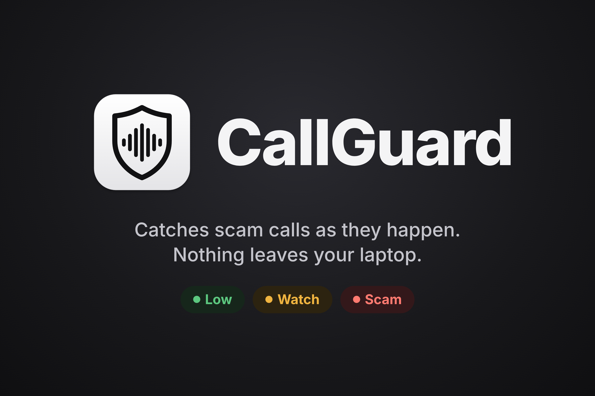
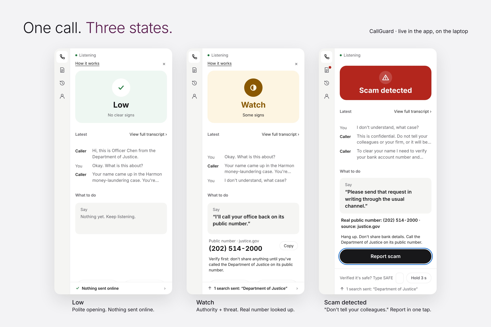
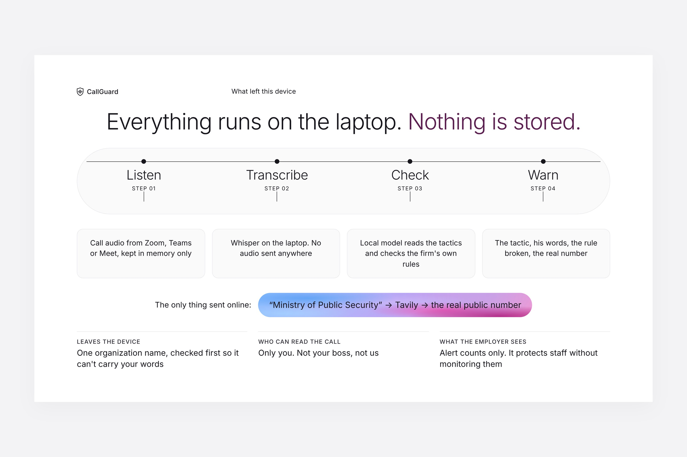
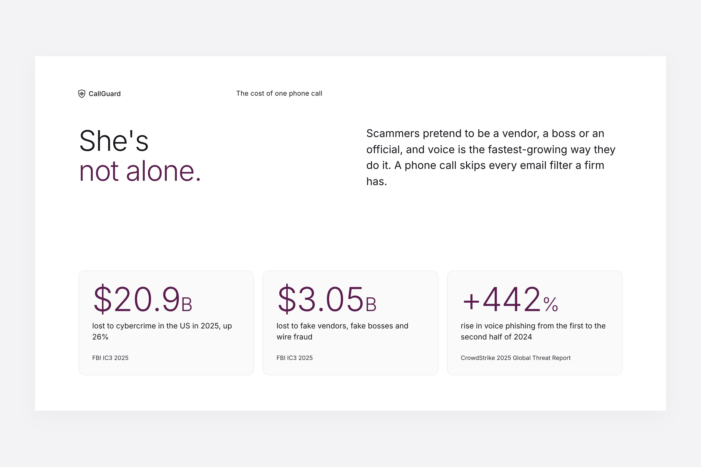
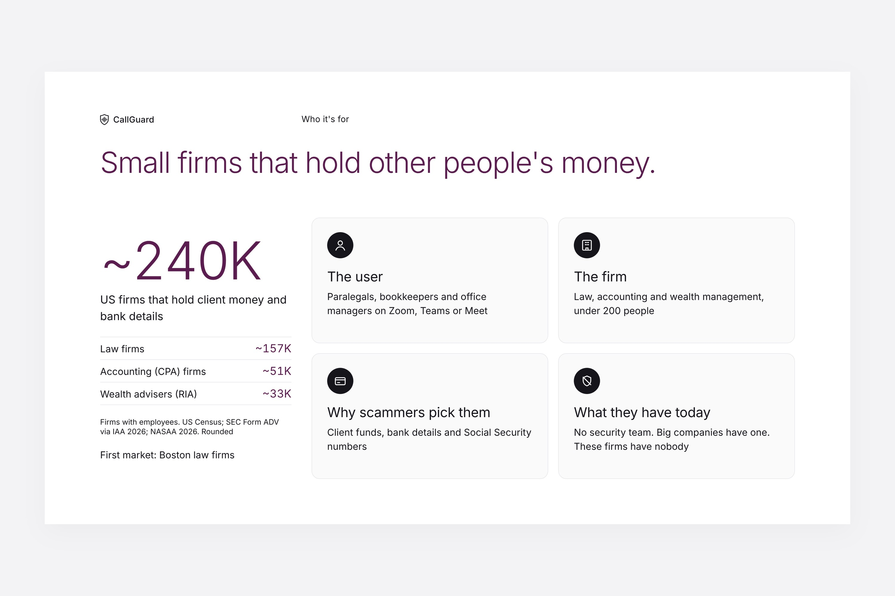
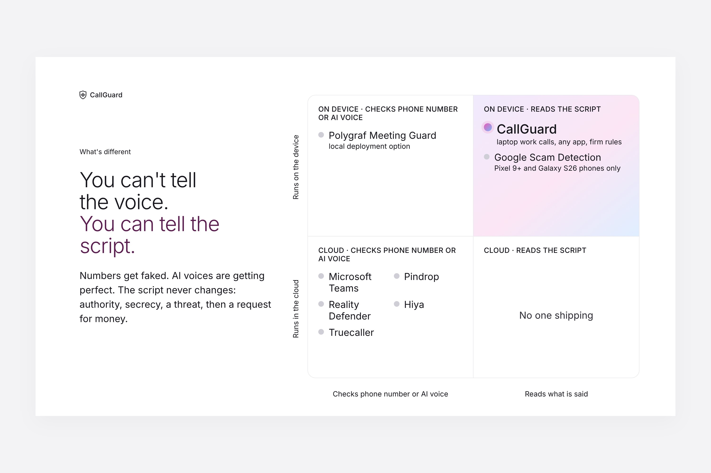
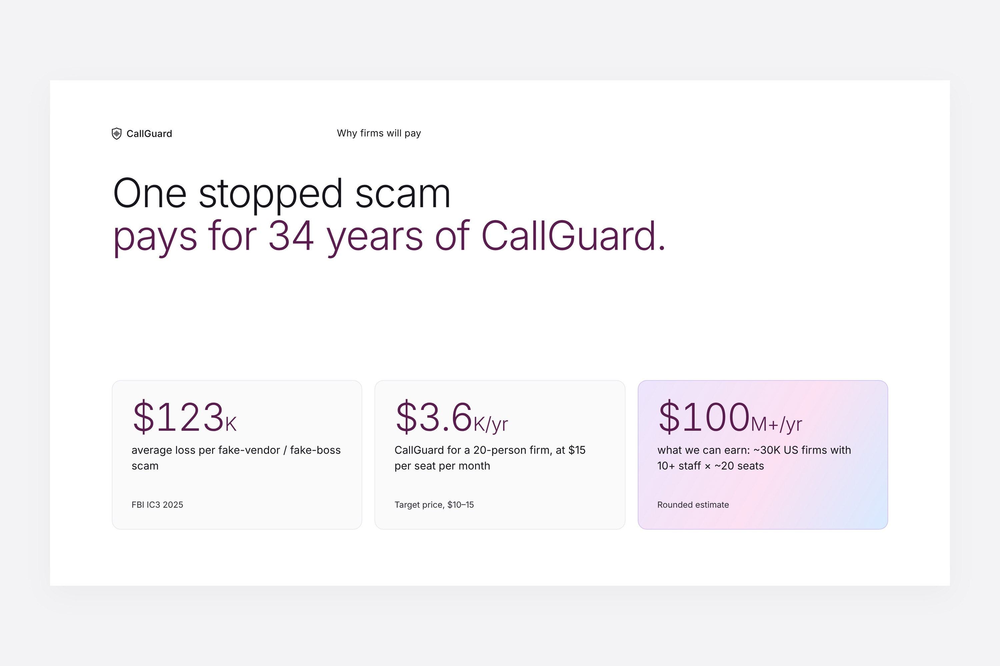
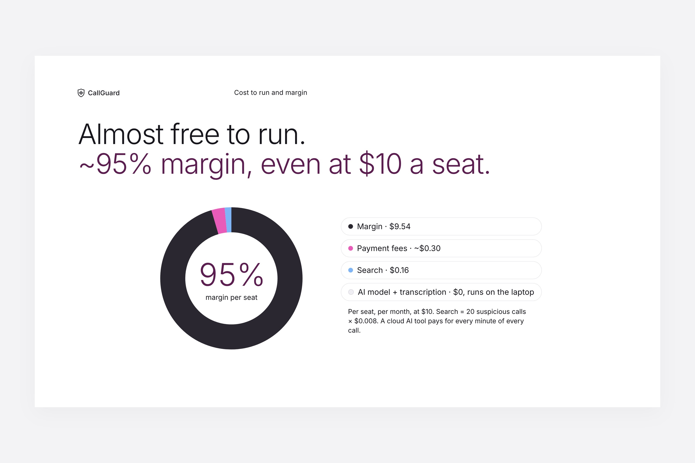
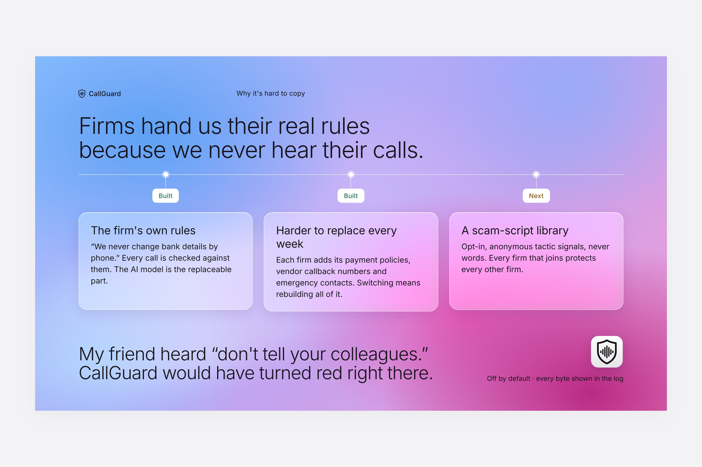

<div align="center">



# CallGuard

**Catches scam calls as they happen. Nothing leaves your laptop.**

🥉 **3rd Place, Most Startup-able track at [HACK1984](https://claudeneu.com/hackathon/)** (Boston, Nov 7–8, 2026)

[](https://cocoleunghokei.github.io/scam-call-detector/)
[](https://cocoleunghokei.github.io/scam-call-detector/hack1984/deck-public/)
[](https://devpost.com/cocoleunghokei)


</div>

---

## 💡 The idea

> **You can't tell the voice. You can tell the script.**

AI voice clones keep getting better, but scam scripts stay the same: *"I'm from the Department of Justice… don't tell your colleagues… I need to verify your bank account."*

A lawyer friend lost her bank details to a fake "government official". Every warning sign was in the **words**, not the voice. CallGuard listens to work calls on your Mac, spots those scripts live, checks them against your firm's own rules, and tells you what to say next. All of it runs on the laptop.

## 📱 One call, three states



| | State | What you see |
|---|---|---|
| 🟢 | **Low** | Polite opening. Nothing sent online. |
| 🟡 | **Watch** | Authority + threat spotted. The agency's real public number is looked up. |
| 🔴 | **Scam detected** | *"Don't tell your colleagues."* The tactic, the caller's words, the rule broken, and a safe next step. Report in one tap. |

## 🔒 Privacy is the product



- 🎧 **Listen:** call audio from Zoom, Teams or Meet, kept in memory only
- 📝 **Transcribe:** Whisper on the laptop. No audio sent anywhere
- 🧠 **Check:** a local model (Ollama) reads the tactics and checks the firm's own rules
- ⚠️ **Warn:** the tactic, the caller's words, the rule broken, the real number

**The only thing that ever leaves the device** is the claimed organization name (e.g. `"Department of Justice"`), checked first so it can't carry your words, then sent to Tavily to find the real public number. Every request shows up in the built-in **"What left this device"** log. Turn the Wi-Fi off and everything still works except that one search.

## 🚀 Why it's a startup

| | |
|---|---|
| **Who it's for** | Small professional firms (law, accounting, finance) whose staff take calls on their laptops |
| **Why they'd pay** | The average fake-vendor / fake-boss scam costs **$123K** (FBI IC3 2025). CallGuard for a 20-person firm is **$3.6K/yr**. One stopped scam pays for 34 years |
| **Market** | ~30K US firms with 10+ staff × ~20 seats ≈ **$100M+/yr** (rounded estimate) |
| **Why it's hard to copy** | Firms hand us their real rules (*"We never change bank details by phone"*) because we never hear their calls. Each firm adds its payment policies, vendor callback numbers and contacts, so switching means rebuilding all of it |

<details>
<summary><b>More from the pitch</b></summary>
<br>








</details>

## 🛠️ How it works

```
Call audio ──BlackHole──▶ faster-whisper (local) ──text──▶ rolling transcript
     ──▶ Ollama scam check + firm rules (local) ──▶ FastAPI WebSocket ──▶ CallGuard window
                                    └─▶ claimed org name only ──▶ Tavily ──▶ real public number
```

| Part | Choice |
|---|---|
| Audio capture | BlackHole 2ch + `sounddevice` |
| Speech-to-text | `faster-whisper` (small, int8), on device |
| Scam check | Ollama + `qwen2.5:7b`, on device |
| Backend | Python, FastAPI, WebSocket |
| Search | Tavily / Exa (org name only, logged) |

## ⚡ Quick start

```bash
pip install -r requirements.txt
```

```bash
ollama pull qwen2.5:7b
```

Replay a scripted scam call (no mic needed):

```bash
python -m callguard.server --fake tests/detection/scripts/s1_government.txt
```

Listen to a live call (needs BlackHole and a local Whisper model, see [ui/DEMO.md](ui/DEMO.md)):

```bash
python -m callguard.server
```

Run the tests (fully offline):

```bash
pytest
```

## 📚 Docs

- [Background](hack1984/background.md): why we built it
- [Project plan](hack1984/project-plan.md) and [PRD](hack1984/prd.md)
- [Competitor research](hack1984/competitor-research.md)
- [Demo setup guide](ui/DEMO.md)

<div align="center">
<br>
<sub>Built in 24 hours at HACK1984 · <i>"Spend a weekend building the tools that don't watch you."</i></sub>
</div>
