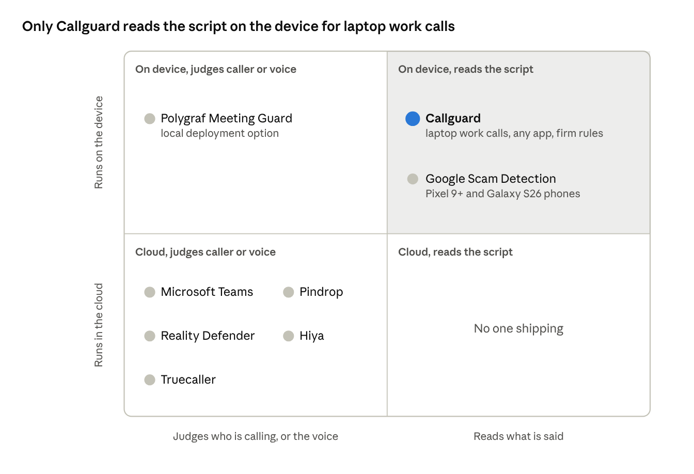

# Callguard Competitor Research

Nov 7, 2026 · Coco · Live, editable version: [Callguard Competitor Research](https://claude.ai/artifact/YFUrzdMLHYtMXQ2VJZu32k)

No shipping product checks what is said on a laptop work call, on the device, for a 10–200 person firm without a security team. Competitors either check who is calling, detect synthetic voices, sit inside one platform, or train staff before the call.

## At a glance

Nine products touch the problem; only Google's Scam Detection checks the script on the device, and only on phones.

| Product | What it checks | Where it runs | Platform | Buyer | Gap Callguard fills |
| --- | --- | --- | --- | --- | --- |
| **Callguard** | What is said: scam tactics + the firm's own rules | On the laptop (Whisper + Ollama) | Any call app on a Mac: Zoom, Teams, RingCentral | Managing partner, firms of 10–200 | — |
| [Microsoft Teams brand impersonation protection](https://mc.merill.net/message/MC1219793) | Who is calling: first-time external callers posing as a known brand | Microsoft cloud | Teams Calling only | IT / security admin on M365 | Teams only; caller identity, not the script; no firm rules |
| [Google Scam Detection](https://support.google.com/phoneapp/answer/15654065?hl=en) | What is said: scam conversation patterns | On the phone (Gemini Nano) | Pixel 9+, Galaxy S26; US-first; carrier calls | Consumers | Phones only; consumer; off by default; no work-call apps; no firm rules |
| [Pindrop Pulse for Meetings](https://www.pindrop.com/article/pindrop-pulse-available-across-conferencing-platforms/) | Synthetic voice and video per participant | Vendor cloud | Zoom, Teams, Webex | Enterprise security teams | Voice-based, so it weakens as clones improve; enterprise-only |
| [Reality Defender RealMeeting](https://www.realitydefender.com/product/realmeeting) | Deepfake voice and video, Trust / Suspicious / Manipulated | Vendor cloud | Zoom, Teams plugin | Enterprise, hiring teams | Voice-based; pitched at interviews, not payment fraud |
| [Polygraf Meeting Guard](https://www.helpnetsecurity.com/2026/07/15/polygraf-ai-meeting-guard-delivers-real-time-deepfake-detection-for-enterprise-meetings) | Deepfake voice, AI content, spoken PII | Bot joins the call; local deployment offered | Zoom, Meet, Teams | Enterprise | Visible bot in the call; meetings, not inbound calls |
| [Hiya AI Voice Detection](https://pt-br.hiya.com/products/protect/ai-voice-detection) | Number reputation + AI-voice detection | Cloud API, carriers, Samsung Smart Call | Phones, carriers | Carriers, OEMs, consumers | Misses new or spoofed numbers; voice-based |
| [Truecaller AI Call Scanner](https://www.speechtechmag.com/Articles/News/Speech-Technology-News/TrueCaller-Launches-AI-Call-Scanner-164270.aspx) | Number lookup + tap-to-scan AI voice | Cloud | Android, US | Consumers (Premium) | Consumer; user must think to tap; voice-based |
| [KnowBe4 vishing](https://www.knowbe4.com/press/knowbe4-combats-voice-based-threats-with-advanced-simulated-vishing-capabilities), [Adaptive Security](https://www.adaptivesecurity.com/blog/vishing) | Trains staff with simulated vishing and deepfake calls | Cloud | Phone, any | Security / HR | Before the call, not during it |

Apple's iOS 27 Impersonation Risk Detection only feeds third-party apps and is off by default, so it is a platform hook, not a competitor ([Fox News](https://www.foxnews.com/tech/anti-scam-settings-iphone-pixel-galaxy-check.print)).

## Positioning map

Google is Callguard's only neighbour, and it lives on phones; the crowded corner judges the caller or the voice in the cloud. Training tools (KnowBe4, Adaptive) sit outside the map because they act before the call.

## Our position

Callguard targets a narrow slice of the on-device, reads-the-script quadrant, not the empty cloud quadrant. That empty corner stays empty on purpose: sending transcripts to a server breaks the product's core promise, and it is the easiest gap for Microsoft or Google to fill.

The slice is the combination no one ships:

1. Reads the script, not the voice
2. Runs on the device
3. Covers laptop work calls in any app (Zoom, Teams, RingCentral)
4. Checks the firm's own rules
5. Sold to 10–200 person firms with no security team

**Pitch line:** "The only scam check for work calls that reads the script, runs on your laptop and knows your firm's rules." Avoid saying "we found white space"; it invites "is there a market?"

**Open questions**

- Is the slice empty because no one wants it? Demand evidence today: the friend's story and Verizon's finding that phone scams succeed ~40% more often than phishing. Not yet shown: that small firms buy security tools themselves rather than through their IT provider (MSP).
- How long does it stay open? Google moving Scam Detection to Meet or Chrome, or Microsoft adding transcript checks to Teams, closes most of the "reads the script" lead. The lasting edge is provable privacy (the egress log), firm rules, and every call app.

## Who could close the gap

Google and Microsoft are the real threats; the deepfake vendors are moving upmarket, not toward small firms.

| Competitor | Threat | How they could reach Callguard's space | Signal to watch |
| --- | --- | --- | --- |
| Google | High | Port Scam Detection from Pixel/Galaxy phones to Chrome, Meet or ChromeOS | Scam Detection appearing in Google Meet or on desktop |
| Microsoft | High | Extend Teams brand-impersonation warnings from caller identity to transcript analysis with Copilot | Defender for Office 365 adding "conversation" signals to Teams calls; a Business Premium SKU tier |
| Pindrop | Medium | Add script analysis to Pulse and a self-serve SMB plan | An SMB price page or a content-based (not voice) detector |
| Hiya | Medium | Its carrier and Samsung reach puts it on every phone; it could add conversation analysis | Hiya Protect adding "what was said" alerts |
| Polygraf, Reality Defender | Low | Already in Zoom and Teams; could add tactic detection | A tactics or policy-rules feature in their meeting products |
| KnowBe4, Adaptive | Low, likely partner | Bundle a live-call companion with training | A desktop agent announcement; also a channel for Callguard's training mode |

## Where Callguard wins and where it is weak

The edge is the combination: script-based, on-device, any call app, and the firm's own rules. Each piece exists somewhere; no one ships all four.

**Wins**

- **Script, not voice.** Pindrop, Reality Defender, Polygraf, Hiya and Truecaller all judge the voice. As clones improve, that signal fades; the script (authority, secrecy, urgency, bank change) does not.
- **Firm rules.** No competitor checks a call against the firm's own policy ("we never change vendor bank details by phone"). This is the hook for a B2B buyer.
- **Provable privacy.** Only the claimed organization name leaves the laptop, and the egress log shows it. Cloud deepfake tools and Microsoft send call data to their servers.
- **No security team needed.** Microsoft, Pindrop and Reality Defender assume an admin or SOC to configure and triage alerts.
- **Any call app.** Works across Zoom, Teams and RingCentral on the Mac; Microsoft covers Teams only.
- **Explains itself.** Google beeps and warns; Callguard says which tactic, which rule, and the real number to call back.

**Weak spots**

- **No mobile.** Phones block third-party apps from call audio; Google and Samsung own that surface. The answer is "check with a colleague".
- **Mac only, BlackHole setup.** Installing a virtual audio device is a hurdle for a non-technical office manager.
- **Local model accuracy.** Qwen 2.5 7B on a laptop will miss more and false-alarm more than a cloud model; tests cover only 7 scripts so far.
- **Consent law.** Massachusetts is an all-party consent state; live transcription without storage still needs a legal read.
- **Small-firm sales are slow.** 10–200 person firms buy through MSPs and IT consultants, not security teams; that channel is untested.

## Pitch implications

Lead with "You can't tell the voice. You can tell the script." It separates Callguard from every deepfake vendor in one line.

| Judge asks | Answer |
| --- | --- |
| What about Microsoft? | Teams only, checks who is calling, needs an M365 admin. We cover every call app and read the script against your firm's rules. |
| Google already does this. | On Pixel and Galaxy phones, for consumers. Work calls happen on laptops in Zoom and Teams, where Google has nothing. |
| Pindrop / Reality Defender? | They detect fake voices for enterprises with a SOC, in their cloud. Voices are getting perfect; scripts are not. Nothing leaves our laptop. |
| Isn't training enough? | KnowBe4 trains before the call. Under pressure, staff forget. We help during the call, and our training mode can plug into theirs. |
| Why won't Google or Microsoft just copy you? | They might for their own platforms. Small firms use a mix of apps and have no security team; firm rules and the egress log are built for them. |

For the Startup track, add one line: deepfake vendors sell to enterprises with security teams; at $10–20 per seat per month, Callguard targets the 20-person firm with none. (Competitor pricing is not public; worth checking at the sponsor fair.)

## Sources

Product details come from vendor pages and press coverage of vendor announcements; accuracy claims are the vendors' own and unverified.

- [MC1219793: Brand impersonation protection for Teams Calling](https://mc.merill.net/message/MC1219793)
- [Help Net Security: Teams calls are about to get a lot harder to fake](https://www.helpnetsecurity.com/?p=369570)
- [Google: Use Scam Detection](https://support.google.com/phoneapp/answer/15654065?hl=en)
- [Android Authority: Google Scam Detection on Galaxy S26](https://www.androidauthority.com/google-scam-detection-samsung-galaxy-s26-3643942/)
- [Pindrop: Pulse available across conferencing platforms](https://www.pindrop.com/article/pindrop-pulse-available-across-conferencing-platforms/)
- [Reality Defender: RealMeeting](https://www.realitydefender.com/product/realmeeting)
- [Help Net Security: Polygraf AI Meeting Guard](https://www.helpnetsecurity.com/2026/07/15/polygraf-ai-meeting-guard-delivers-real-time-deepfake-detection-for-enterprise-meetings)
- [Hiya: AI Voice Detection](https://pt-br.hiya.com/products/protect/ai-voice-detection)
- [Speech Technology: Truecaller AI Call Scanner](https://www.speechtechmag.com/Articles/News/Speech-Technology-News/TrueCaller-Launches-AI-Call-Scanner-164270.aspx)
- [KnowBe4: simulated vishing](https://www.knowbe4.com/press/knowbe4-combats-voice-based-threats-with-advanced-simulated-vishing-capabilities)
- [Adaptive Security: vishing](https://www.adaptivesecurity.com/blog/vishing)
- [Fox News: anti-scam settings on iPhone, Pixel, Galaxy](https://www.foxnews.com/tech/anti-scam-settings-iphone-pixel-galaxy-check.print)
- Callguard repo: [background.md](background.md) (competitor table, target buyer, pricing hypothesis)
