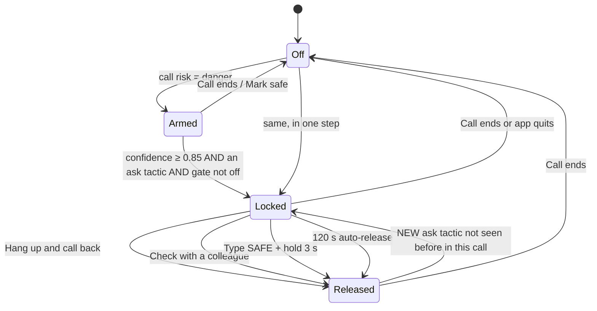
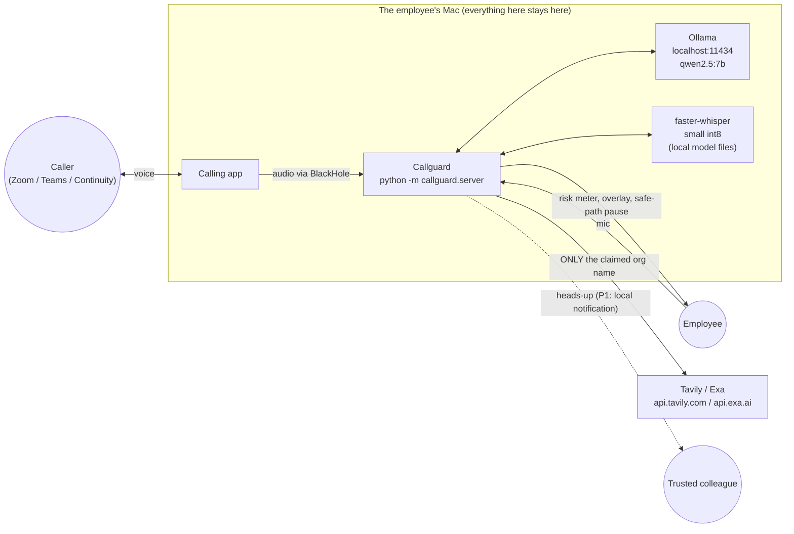
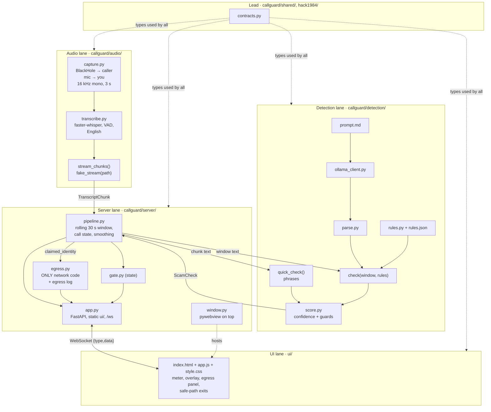
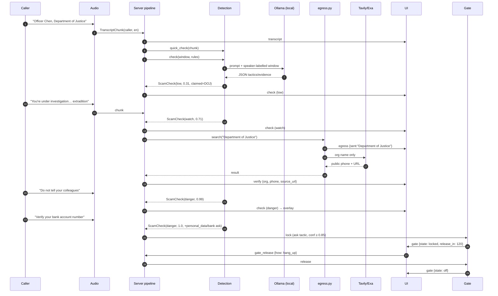
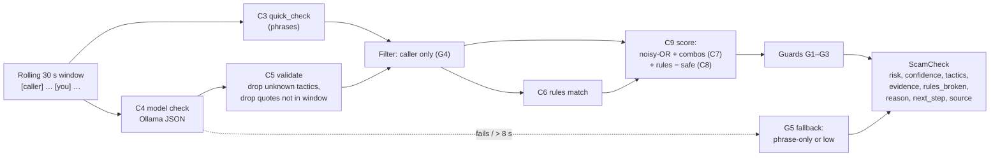
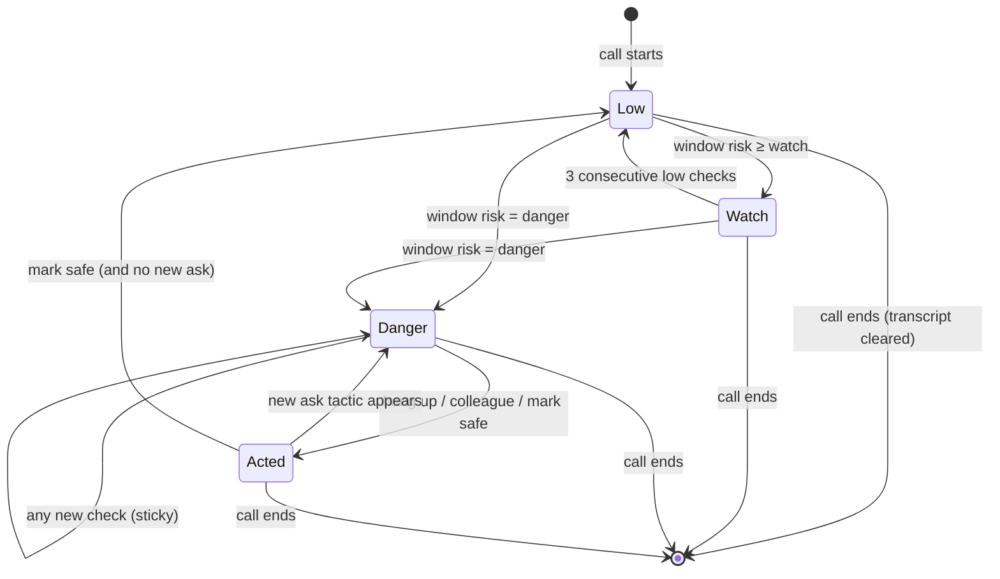
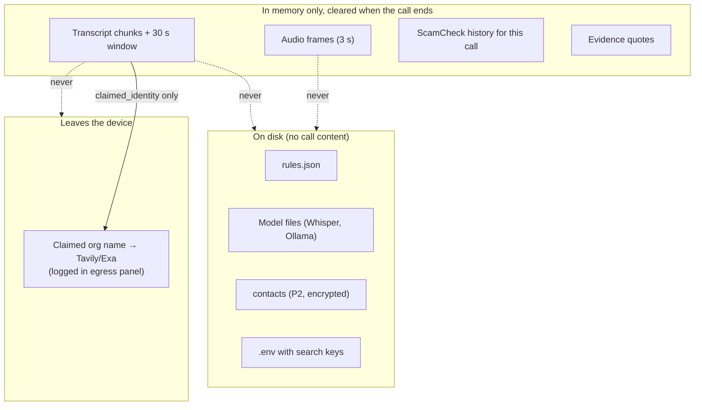
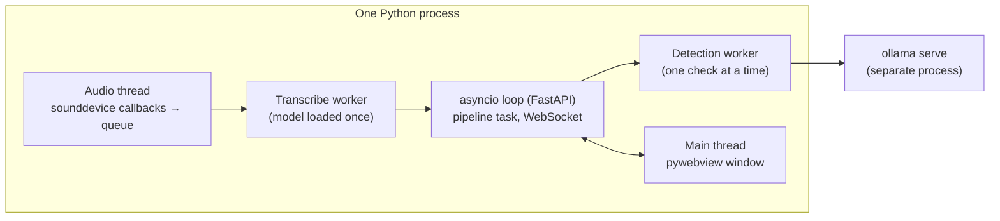
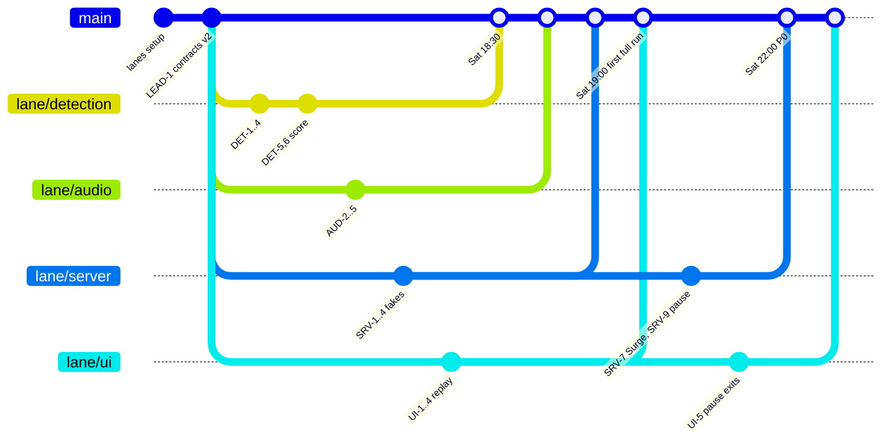
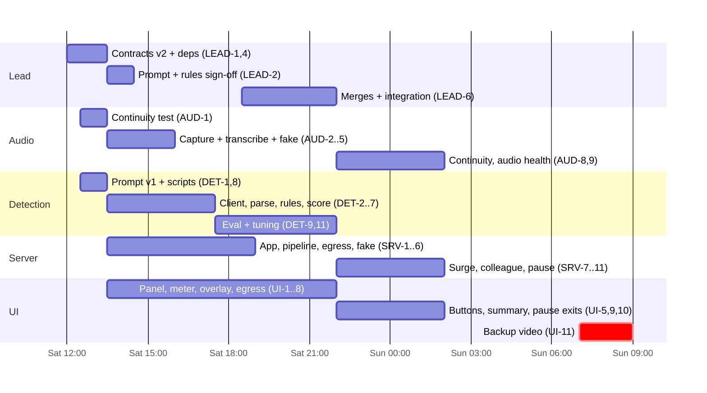

# Callguard PRD (HACK1984)

Owner: Coco (Lead) · Status: v1 draft for review · Last updated: Sat Nov 7, 2026
Code freeze: **Sun Nov 8, 11:00 ET**

Read with: [background.md](background.md) (why), [project-plan.md](project-plan.md) (what and when), root [AGENTS.md](../AGENTS.md) (lanes, guardrails, contracts), [competitor-research.md](competitor-research.md) (who else is in the space; drives [2.4](#24-competitive-position-and-what-it-protects-in-scope)).

This document is the detailed build spec. It turns the background and plan into requirements that each lane can pick up on its own branch, build against fakes, and hand to Coco for review. Every requirement has an ID (`AUD-`, `DET-`, `SRV-`, `UI-`, `LEAD-`), one owning lane, a priority, and a "done when" line, so a lane agent can commit against it (`DET-6: confidence scorer`) and Coco can review one requirement at a time.

---

## Contents

1. [Summary](#1-summary)
2. [Problem and users](#2-problem-and-users)
3. [Goals, non-goals and success measures](#3-goals-non-goals-and-success-measures)
4. [Scam scenario catalog](#4-scam-scenario-catalog)
5. [The checks](#5-the-checks)
6. [Confidence score and risk levels](#6-confidence-score-and-risk-levels)
7. [The safe-path pause](#7-the-safe-path-pause)
8. [Firm rules](#8-firm-rules)
9. [User experience](#9-user-experience)
10. [Architecture and tech diagrams](#10-architecture-and-tech-diagrams)
11. [Privacy model](#11-privacy-model)
12. [Contract changes (v2)](#12-contract-changes-v2)
13. [Lane work breakdown](#13-lane-work-breakdown)
14. [Integration, merge order and review](#14-integration-merge-order-and-review)
15. [Testing and evaluation](#15-testing-and-evaluation)
16. [Failure modes](#16-failure-modes)
17. [Risks and open questions](#17-risks-and-open-questions)
18. [Appendix: copy, keywords, next steps](#18-appendix-copy-keywords-next-steps)

---

## 1. Summary

**Callguard** is a Mac desktop app that sits beside a work call (Zoom, Teams, RingCentral, and iPhone calls answered on the Mac if the Continuity test passes). It listens to the call, transcribes it on the laptop, and watches *what is being said* for the shape of a scam script: someone claiming authority, asking for secrecy, threatening, rushing, and then asking for money, a bank change, a login code or client data. It checks those signals against the firm's own rules ("We never change vendor bank details by phone"), works out how confident it is, and warns the employee in plain words. At the highest level of confidence, when the caller has asked for something the employee could type (a code, an account number, a wire), it puts the safe choice in front of them (hang up and call back, or check with a colleague) before they act. It never freezes the keyboard: the caller can ask for anything on any platform, and a frozen keyboard on a false alarm hurts more than it helps.

All of this runs on the laptop. The only thing that ever leaves the device is the **name of the organization the caller claims to be**, sent to Tavily or Exa to find that organization's real public phone number, and that request is shown in a "What left this device" log.

The pitch line: **"You can't tell the voice. You can tell the script."**

---

## 2. Problem and users

### 2.1 The problem
Phone scams aimed at staff succeed far more often than email phishing, and AI voice cloning has removed the last cue people relied on: the voice. Existing tools check *who* is calling (number reputation, caller organization). Scammers rotate and spoof numbers, so those checks miss. Very little checks *what* is being said, and nothing does it for small firms on the laptop, during the call, without sending the conversation to a cloud.

The standard advice, "hang up and call back on the number on file," depends on a stressed employee remembering it at the exact moment a convincing caller is telling them not to. Callguard's job is to remind them at that moment, with the number in hand, and to make the unsafe action harder than the safe one.

### 2.2 Who it is for

| | |
|---|---|
| **User** | Staff who take calls at their laptop in professional-services firms: paralegals, bookkeepers, accounts payable, office managers |
| **Buyer** | Managing partner or office manager at a firm of 10–200 people with no security team |
| **Why them** | They hold client funds, bank details and Social Security numbers. Scammers know it. They have no Defender team watching |
| **Origin story** | A lawyer friend was called by a fake "government official," told she was under investigation, told not to tell her teammates, and asked for her bank details. She gave them. Every warning sign was in the words |

### 2.4 Competitive position and what it protects in scope
From [competitor-research.md](competitor-research.md): nobody ships the combination of **reads the script, runs on the device, covers any laptop call app, and checks the firm's own rules**, for firms with no security team. Each piece exists somewhere (Google reads the script but only on phones; Microsoft warns but only in Teams and only on caller identity; Pindrop, Reality Defender, Polygraf, Hiya and Truecaller judge the voice, in the cloud). Google or Microsoft could close the "reads the script" lead on their own platforms, so the lasting edge is **provable privacy, firm rules, and every call app**.

That makes these requirements **protected**: they are not cut at the Sun 02:00 P1 decision, and each one must be visible in the demo.

| Differentiator | Answers which competitor | Protected requirements | Demo moment |
|---|---|---|---|
| Script, not voice | Pindrop, Reality Defender, Polygraf, Hiya, Truecaller | DET-1..9 | Gradium clone opener, then the script gets caught |
| Firm rules | Everyone (no one checks firm policy) | DET-4, UI-3, UI-4 (rules panel UI-13 and rules editor UI-14 are P1) | "This breaks your firm's rule" on S2 |
| Provable privacy | Microsoft and cloud deepfake tools | SRV-3, SRV-12, UI-6 | Wi-Fi off + egress log |
| Any call app | Microsoft (Teams only) | AUD-1 (Zoom + Teams routes) | "Same app on Zoom and Teams" |
| Explains itself | Google (beeps without explaining) | UI-3, UI-4 (tactic, caller's words, rule, number) | Overlay with quotes |
| Answer for mobile | Google and Samsung own the phone | SRV-13, UI-5 ("Check with a colleague") | One tap to a colleague |

### 2.5 Jobs to be done
1. *While on a call*, tell me early and in plain words when the call looks like a known scam pattern, so I can slow down.
2. *When the caller asks me to do something risky*, stop me from doing it on autopilot and give me the safe alternative (the real number, a colleague).
3. *Before I'll trust you with my calls*, prove that my calls are not being recorded, uploaded or shown to my employer.

---

## 3. Goals, non-goals and success measures

### 3.1 Goals (this weekend)
- **G1. Catch the script live.** Detect the four headline scenarios (government official, vendor bank change, IT code, cloned partner wire) on a real Zoom call and raise the right risk level within about 10 seconds of the giveaway sentence.
- **G2. Stay quiet on real calls.** No `danger` on any benign twin scenario.
- **G3. Prove privacy live.** Wi-Fi off mid-demo, the scam is still caught, and the egress log shows only organization names.
- **G4. Make the safe path the easy one.** At high confidence with a sensitive request, the danger overlay asks the employee to choose a next step, with "Hang up and call back" first. Nothing is blocked.
- **G5. Verify the claim (Surge).** Show the claimed organization's real public number from Tavily or Exa.

### 3.2 Non-goals
iPhone or Android apps, a browser extension, languages other than English (Mandarin was removed), voice/deepfake detection (a crowded space whose signal fades as clones improve, see 2.4), caller-ID lookup, storing audio or transcripts, an employer-side transcript view, cloud LLMs, multi-user accounts, Windows support, production installer/signing.

### 3.3 Success measures

| Measure | Target | How we check |
|---|---|---|
| P0 scams (S1–S4) rated `danger` | 4 of 4 | `DET-9` eval table |
| Full scam set (S1–S10) rated `danger` | ≥ 9 of 10 (P1) | `DET-9` eval table |
| Benign twins rated `danger` | 0 of the P0 twins (B1, B2, B3, B7); 0 of 7 once the P1 set is added | `DET-9` eval table |
| Benign twins rated `low` | ≥ 5 of 7 (the rest `watch`) | `DET-9` eval table |
| Plan scripts 1–6 correct | ≥ 5 of 6 (plan's bar) | `DET-9` |
| Giveaway sentence spoken → `danger` on screen | ≤ 10 s (stretch ≤ 7 s) | Stopwatch on the Zoom run, `SRV-2` timing log |
| First `watch` hint from fast check | ≤ 5 s after the phrase (P1, needs DET-5) | Same |
| Egress log entries per call | Only org names; ≤ 1 per org per call | Demo + `SRV-12` test |
| Call apps verified end to end | Zoom **and** Teams (RingCentral if time) | AUD-1 routes table |
| Every danger warning explains itself | Names the tactic, quotes the caller, names the firm rule (if any), gives a next step with a number | UI-4 fixture test on S1, S2, S3 |
| Works with the Wi-Fi off | Everything but search; search says "offline, skipped" | Sat 22:00 checkpoint |
| Files written during a call | 0 | `SRV-12` no-disk-writes test |

### 3.4 Priority ranking

**What the tiers mean**
- **P0, must ship to win.** The minimum product that wins Privacy-First and supports the Startup and Surge pitches. If a P0 is missing on Sunday, the demo or a judging answer breaks. P0 is not cut.
- **P1, stretch.** Makes the demo more memorable or the Q&A stronger, but we win without it. Start only after the Sat 22:00 P0 checkpoint; whatever isn't working by Sun 02:00 is cut.
- **P2, scoped out.** Not built this weekend. Mention it in the pitch as roadmap if it helps.

**How it was ranked.** Every requirement was scored against three things:
1. **Winning strategy** ([background §4](background.md)): prove privacy live (Wi-Fi off + egress log), lead with the friend's story, "you can't tell the voice, you can tell the script," one buyer and one platform, be honest about limits ("check with a colleague"), a demo that can't fail (backup video).
2. **Competitive edge** ([2.4](#24-competitive-position-and-what-it-protects-in-scope)): script not voice, firm rules, provable privacy, any call app, explains itself.
3. **Vision**: on-device scam-script detection that a 10–200 person firm with no security team can use during the call.

A requirement is P0 only if one of these breaks without it. Within each tier, rank 1 matters most; enablers are listed separately because they come first in time but are not demo features.

#### P0 enablers (do first)

| ID | Lane | Why it can't wait |
|---|---|---|
| LEAD-1 | Lead | Contracts v2: every lane builds on the new fields (confidence, evidence, gate) |
| LEAD-2, LEAD-3 | Lead | Prompt and rules sign-off; pinned dependencies |
| AUD-5, SRV-4, UI-8 | Audio, Server, UI | Fakes and replay: lanes build in parallel, and the demo can run from a script if the live call fails |
| LEAD-6 | Lead | Merges and the integration checklist at each checkpoint |

#### P0, ranked (the MVP that wins)

| Rank | IDs | Lane | Why it is must-ship |
|---|---|---|---|
| 1 | AUD-2, AUD-3, AUD-4 | Audio | Live capture and local transcription. Without it nothing runs, and "on the laptop" is the product |
| 2 | DET-1, DET-2, DET-3, DET-7 | Detection | The local model reads the script. This *is* "you can't tell the voice, you can tell the script," and the edge over every voice-based competitor |
| 3 | DET-4 (5 P0 rules) | Detection | Firm rules: the one thing no competitor does, and the hook for the business buyer |
| 4 | DET-6, SRV-7 | Detection, Server | Confidence score, guards and sticky danger. Without them, real calls false-alarm and the warning flickers on stage |
| 5 | SRV-1, SRV-2, SRV-11 | Server | Pipeline and WebSocket that put the result on screen, in a native Mac window (no browser) that stays on top and comes to the front on danger (no full-screen) |
| 6 | UI-2, UI-3, UI-4 | UI | Meter, watch note and danger overlay that explain themselves (tactic, the caller's words, rule, next step). The edge over Google's beep |
| 7 | SRV-3, UI-6, SRV-12 | Server, UI | Egress log and privacy tests. Strategy #1 and the main track's "can you prove it" |
| 8 | LEAD-4, SRV-6 (online) | Lead, Server | Wi-Fi-off run from a cold start, with models pre-downloaded. The live privacy proof |
| 9 | AUD-1 (Zoom + Teams) | Audio + Coco | Zoom must pass (main platform); Teams proves "any call app" against Microsoft |
| 10 | DET-8 (P0 set), DET-9, DET-11 | Detection | S1–S4 and their twins pass on 7b. Evidence for "would anyone use it" and the false-alarm answer |
| 11 | SRV-8 | Server | Surge lookup. Gives the egress log one real, visible entry, puts the real number on the overlay, and is a separate prize |
| 12 | SRV-13, UI-5 (colleague exit) | Server, UI | "Check with a colleague": the honest answer to "she was on her mobile" |
| 13 | SRV-9, UI-5 (safe-path pause) | Server, UI | Deliberate exits on the danger screen; the safe path is one click, "mark safe" takes effort. Cheap, no OS hooks |
| 14 | SRV-5, AUD-6, UI-7 | Server, Audio, UI | Transcript cleared at call end; no-file-write tests; only a short transcript tail shown |
| 15 | UI-1 | UI | "Listening locally · nothing stored" badge and consent line (Massachusetts question) |
| 16 | LEAD-5, LEAD-9, LEAD-7 | Lead | Friend's consent and organizer answers; the Gradium opener; the demo script with exact caller lines |
| 17 | UI-11 | UI | Backup video by Sun 09:00. The demo can't fail |

#### P1, ranked (stretch)

| Rank | IDs | Lane | Why it is a stretch, not must-ship |
|---|---|---|---|
| 1 | DET-5 (C3) | Detection | Phrase check: an earlier hint and a fallback if the model stalls. The model alone meets the latency target |
| 2 | UI-13, UI-14, SRV-14, DET-13 | UI, Server, Detection | Firm rules panel, then the editor that lets a company write its own rules and its own "Never search for" list ([8.2](#82-never-search-list-p1)). Strengthens the "firm rules" differentiator ([2.4](#24-competitive-position-and-what-it-protects-in-scope)); the P0 rules already appear in the warnings |
| 3 | UI-15 | UI | "Say this" lines: one fixed sentence per tactic that the user can say to the caller ([18.3](#183-say-this-lines)). Cheap, fixed copy, works offline; turns a warning into something the user can act on under pressure |
| 4 | SRV-15, UI-16 (C17) | Server, UI | Scam-report search: one more search per claimed organization for recent impersonation reports, shown as one line on the overlay. A second real-time use of search for the Surge pitch |
| 5 | DET-12, DET-8 P1 set | Detection | Four more rules and S5–S10, B4–B6. Wider coverage for Q&A, not needed for the demo |
| 6 | AUD-9, SRV-6 (model health, C15) | Audio, Server | Plain-language errors when BlackHole or Ollama is missing. Helps setup; the backup video covers a stage failure |
| 7 | UI-9 | UI | Colleague and safe buttons outside the danger screen |
| 8 | AUD-8 | Audio | iPhone calls answered on the Mac, only if the Continuity test passed. Strategy #4: one platform, no phone workarounds |
| 9 | SRV-13 (real message) | Server | Sending to an actual contact instead of a local notification |
| 10 | LEAD-8 | Lead | Contract tests |

#### P2, scoped out

| IDs | Why it is out |
|---|---|
| UI-10 (post-call summary card with evidence quotes and "Copy for a report") | Nice after-call touch; judges score the during-call moment |
| Scam alert feed (FTC consumer alerts, FBI IC3): fetched at startup, kept in memory, matched against the claimed organization and tactics during calls; a "Scams going around this week" card when no call is active | Nothing about any call leaves the device, but needs a feed parser, matching and a source decision. Roadmap; pairs with training mode |
| C13 (known-contact check, encrypted contact list) | Needs setup UI and encrypted storage; Surge already supplies a real number |
| Training mode, admin anonymous counts, Phonon coach line | Roadmap for the Startup pitch (training mode can partner with KnowBe4/Adaptive), not this weekend |
| `inside_knowledge` tactic | Weight 0.2, an amplifier only; S1 reaches danger without it |
| SRV-10 hard keyboard gate (cut) | Freezing typing system-wide doesn't stop a caller who asks for the code by SMS, email or another device, and a false alarm locks someone out of their work. The danger overlay and the safe-path pause cover the idea without the harm |

---

## 4. Scam scenario catalog

This is the shared reference for prompt writing, keyword lists, rule writing, test scripts, the eval, and the demo. **Detection** turns each row into a script under `tests/detection/scripts/` (format in [15.2](#152-script-file-format)). **Audio**'s `fake_stream()` replays the same files, so the Server and UI lanes can run every scenario without a call.

Every scam scenario has a **benign twin**: a real call that shares surface features (authority, urgency, money, a bank) but is not a scam. The twins are how we keep false alarms down and prove "verify first, not fraud."

### 4.1 Overview

| ID | Scenario | Caller claims | What they want | Tactics | Rules broken | Expected | Plan # |
|---|---|---|---|---|---|---|---|
| **S1** | Government official (the friend's case) | DOJ / police / "China Public Security Bureau" | Bank details, a "verification" transfer | authority, threat, secrecy, inside_knowledge, personal_data_request or bank details | `government_never_calls_for_payment_or_bank_details`, `never_keep_calls_secret` | danger | 1 |
| **S2** | Vendor bank change | Known vendor's accounts team | Update bank details before Friday's payment | bank_change, urgency | `no_bank_changes_by_phone` | danger | 2 |
| **S3** | IT support code | Firm's IT / Microsoft | The MFA code "we just sent you" | authority, urgency, credential_request | `it_never_asks_for_codes` | danger | 3 |
| **S4** | Cloned partner wire | Managing partner (cloned voice) | Urgent escrow wire, skip the usual sign-off | payment_request, urgency, bypass_approval, secrecy | `wires_need_two_approvals` | danger | — |
| **S5** | Bank "safe account" | Bank fraud department | Move firm funds to a "safe account" | authority, threat, urgency, payment_request | `no_payments_to_new_accounts_by_phone` | danger | — |
| **S6** | Tax authority fine | IRS / state revenue | Pay a "penalty" now by gift cards or crypto | authority, threat, urgency, payment_request | `no_gift_card_or_crypto_payments`, `government_never_calls_for_payment_or_bank_details` | danger | — |
| **S7** | Client wire redirect | A real client, mid-closing | Send settlement or escrow funds to a "new" account | bank_change, payment_request, urgency | `no_bank_changes_by_phone` | danger | — |
| **S8** | Remote-access support | IT / software vendor | Install AnyDesk/TeamViewer, "just accept the prompt" | authority, remote_access, urgency | `no_remote_access_from_callers` | danger | — |
| **S9** | Fake auditor / regulator | Bar association / auditor / regulator | Client list, SSNs, matter details | authority, personal_data_request, threat | `never_share_client_data_by_phone` | danger | — |
| **S10** | Jury duty / warrant | US Marshals / court clerk | Pay a fine to avoid arrest, stay on the line | authority, threat, secrecy, payment_request | `government_never_calls_for_payment_or_bank_details` | danger | — |
| **B1** | Real vendor invoice question | Vendor | Clarify an invoice line, no money moves | — | — | low | 4 |
| **B2** | Colleague with a deadline | Colleague | Move a meeting, "need this by 5" | urgency | — | low | 5 |
| **B3** | Real bank fraud check | Bank | Confirm a charge, "call the number on your card" | authority (+ safe signal) | — | low/watch | 6 |
| **B4** | Real IT ticket | Firm IT | Reboot, "never share your code with anyone, including me" | authority (+ safe signal) | — | low | — |
| **B5** | Partner wire, proper process | Managing partner | A wire, "put it through the normal two approvals" | payment_request (+ safe signal) | — | low/watch | — |
| **B6** | Client confirming in writing | Client | "I emailed the new details, please call me back on the number you have" | bank_change (+ safe signals) | — | watch | — |
| **B7** | You say the scary words | You (the employee) | "Don't tell anyone, it's a surprise party for Sam" | secrecy, but said by **you** | — | low | — |

**Scenario priority.** P0 set (must pass to win, and is what the demo uses): **S1, S2, S3, S4** and twins **B1, B2, B3, B7**. P1 set (broader coverage for judge Q&A): S5–S10, B4–B6.

### 4.2 Scenario details

Each scenario lists the beats of the script in order, with the expected risk after each beat. The beat marked ⚡ is the **giveaway**: the moment the warning must be on screen by. The 🔒 beat is where the safe-path pause is expected to open (only scenarios with an ask).

#### S1. Government official (the friend's case)
*Why it works:* authority plus fear plus isolation. The victim is told she is personally in trouble, that a single mistake makes it worse, and that she must not tell anyone, which removes the colleague who would have said "that's a scam." Inside knowledge (a real case name) makes it believable.

| Beat | Caller says | Risk after | Confidence (approx.) |
|---|---|---|---|
| 1 | "Hi, this is Officer Chen from the Department of Justice." | low | 0.31 |
| 2 | "Your name came up in the Harmon money-laundering case. You're under investigation and could face extradition." | watch | 0.71 |
| 3 ⚡ | "This is confidential. Do not tell your colleagues or your firm, or it will be treated as obstruction." | **danger** | 0.99 |
| 4 🔒 | "To clear your name I need to verify your bank account number and routing number." | danger + pause | 1.00 |

*Next step:* "Hang up. Don't share bank details. Call the Department of Justice on its public number: …" *Verify:* `Department of Justice`.

#### S2. Vendor bank change
*Why it works:* routine-sounding admin, a real vendor name, a real upcoming payment, and a deadline.

| Beat | Caller says | Risk after |
|---|---|---|
| 1 | "Hi, it's Dana from Brightline Supplies accounts." | low |
| 2 ⚡ | "We've switched banks, so Friday's payment needs to go to our new account." | **danger** (rule broken) |
| 3 🔒 | "Can you update it now while I'm on the line? Account ending 4471, routing…" | danger + gate |

*Next step:* "Don't change any bank details. Call Brightline back on the number already on file."

#### S3. IT support code (MGM-style)
| Beat | Caller says | Risk after |
|---|---|---|
| 1 | "This is Jake from IT, we've seen suspicious logins on your account." | low/watch |
| 2 ⚡🔒 | "I've just sent a code to your phone. Read it to me so I can lock the attacker out." | **danger** + gate |

*Next step:* "IT never asks for your code. Don't read it out. Message IT on the help desk channel."

#### S4. Cloned partner wire
*Why it works:* the voice is right (Gradium clone in the demo opener), the person is senior, and they give a reason the normal process can't happen.

| Beat | Caller says | Risk after |
|---|---|---|
| 1 | "Hey, it's David. I'm about to board, I've got two minutes." | low |
| 2 ⚡ | "I need you to wire the Pearson escrow funds before five. Skip the second sign-off, I'll approve it when I land." | **danger** |
| 3 🔒 | "Keep this between us until it closes. I'll text you the account." | danger + gate |

*Next step:* "Don't send it. Wires need two approvals. Call David back on his saved number."

#### S5. Bank "safe account"
"This is the fraud team at Chase. Your firm's operating account has been compromised. ⚡ We need you to move the balance to a protected account today before the attackers drain it. 🔒 I'll give you the account number."
*Next step:* "Banks never ask you to move money to a 'safe account.' Call the number on your bank card."

#### S6. Tax authority fine
"This is the IRS enforcement division. There's an unpaid penalty on your firm's filing and a lien is being issued today. ⚡ You can settle it now with Apple gift cards or Bitcoin. 🔒 Read me the card numbers."
*Next step:* "The IRS never takes gift cards or crypto. Hang up and check at irs.gov."

#### S7. Client wire redirect
"Hi, it's Maria Lopez, the closing is today. ⚡ Our bank flagged the old account, so please send the settlement funds to this new one instead. 🔒 Ready for the numbers?"
*Next step:* "Don't change where funds go based on a call. Call the client back on the number in the file."

#### S8. Remote-access support
"Microsoft support here, your laptop is sending us error reports. ⚡ Go to anydesk.com and install it, then read me the nine-digit address. 🔒"
*Next step:* "Don't install anything a caller asks for. Close the page and tell IT."

#### S9. Fake auditor / regulator
"I'm with the state bar's trust account audit. We're reviewing your client trust ledger. ⚡ Email me the client list with Social Security numbers by end of day or the firm will be referred for discipline."
*Next step:* "Don't share client data on a call. Ask for the request in writing and check with the managing partner."
(No gate: the ask is an email, not something typed during the call. Danger overlay only.)

#### S10. Jury duty / warrant
"This is Deputy Ross, US Marshals. You missed jury duty and there's a warrant. Stay on the line, don't hang up and don't call anyone. ⚡ You can pay the bond now to avoid arrest. 🔒"
*Next step:* "Courts don't take payment by phone. Hang up and call the court's public number."

#### Benign twins
- **B1 Real vendor invoice.** "Line 3 on invoice 2210 has the wrong quantity, can you resend it?" No ask, no pressure. → low.
- **B2 Colleague with a deadline.** "Can we push the 3pm? I need the draft by five." Urgency alone. → low (guard rule G1).
- **B3 Real bank.** "We saw a $2,400 charge. If you don't recognize it, please hang up and call the number on the back of your card." Authority, but a strong safe signal (sends you to a known number). → low or watch.
- **B4 Real IT.** "We're patching laptops tonight, please restart before you leave. Reminder: never share your MFA code with anyone, including us." → low.
- **B5 Partner wire, proper process.** "Can you set up the Pearson wire? Put it through the normal two approvals." Money ask plus safe signal. → low or watch, **never danger**.
- **B6 Client confirming in writing.** "I emailed you our new bank details. Please don't act on this call, call me back on the number in your file." Bank change plus two safe signals. → watch at most.
- **B7 You say it.** The employee says "don't tell anyone, it's a surprise party." Secrecy evidence from `speaker: "you"` is ignored. → low.

---

## 5. The checks

Callguard runs a stack of checks. Some run on every 3-second chunk, some on the rolling 30-second window, some once per call. The table says what each one does, who owns it, and when it is needed.

| # | Check | What it does | Runs | Owner | Priority |
|---|---|---|---|---|---|
| **C1** | Speaker attribution | Each chunk is labelled `caller` or `you` by its audio source (BlackHole vs mic). Tactic evidence only counts when the **caller** said it | Every chunk | Audio (labels), Detection (filters) | P0 |
| **C2** | Silence / noise gate | Skip chunks below an RMS threshold or with no words, so the model isn't called on silence | Every chunk | Audio | P0 |
| **C3** | Fast phrase check | Local keyword and regex match (English) for each tactic: "don't tell", "read me the code", "gift cards", "new account" … Gives an early `watch` within ~1 s of the chunk. **Can never raise `danger` alone** | Every caller chunk | Detection (`quick_check`) | P1 |
| **C4** | Model tactic check | Ollama `qwen2.5:7b` reads the speaker-labelled rolling 30 s window and returns tactics, evidence quotes with strength, claimed identity, safe signals, reason and next step as JSON | Every new caller chunk, skipped if one is still running | Detection (`check`) | P0 |
| **C5** | Output validation | Validate model JSON against `ScamCheck`; drop unknown tactics; drop evidence quotes that don't appear in the window (hallucination guard); never crash | Every model call | Detection (`parse`) | P0 |
| **C6** | Firm rules check | Match detected tactics (and optional rule keywords) to `rules.json`; fill `rules_broken` | Every check | Detection (`rules`) | P0 |
| **C7** | Combination check | Known dangerous pairs (authority + secrecy, bank change + urgency, credential + authority …) add to the score | Every check | Detection (`score`) | P0 |
| **C8** | Safe-signal check | Signs of a legitimate call lower the score: sends you to a known number, follows the normal approval, no money or data asked, asks for it in writing | Every check | Detection (prompt + `score`) | P0 |
| **C9** | Confidence score and guards | Combine C3–C8 into a 0–1 `confidence` and a risk level, applying the guard rules (urgency alone never danger, danger needs an ask or a strong combo) | Every check | Detection (`score`) | P0 |
| **C10** | Call-level smoothing | Turn a stream of per-window checks into a stable meter: rises immediately, `danger` is sticky until the user acts or the call ends, `watch` decays after ~10 s of low | Every check | Server (`pipeline`) | P0 |
| **C12** | Claimed-identity verify (Surge) | Once per organization per call, when `confidence ≥ 0.40` and `claimed_identity` is set, send **only the org name** through `egress.search()`; return the public phone and source URL | Once per org | Server | P0 |
| **C17** | Scam-report search (Surge, P1) | Same trigger as C12, once per org per call: search `"{org}" impersonation scam` through `egress.search()`; return the most recent matching report (one-line summary, source URL, date) if it is from the last 12 months | Once per org | Server | P1 |
| **C13** | Known-contact check | Compare `claimed_identity` with the firm's local contact list and show "Number on file: …" | Once per org | Server (lookup), Detection (none) | P2 |
| **C14** | Gate eligibility | Decide whether the safe-path pause should open (see [7](#7-the-safe-path-pause)) | Every check | Server (`gate`) | P0 |
| **C15** | Model health | Ping Ollama at start and after failures; if down or slower than 8 s, run on C3 only and show "Basic checks only" | Startup + on error | Server, Detection | P1 |
| **C16** | Online check | Detect network presence for `status.online`; search returns `offline` instead of erroring | Startup + every 15 s | Server (`egress`) | P0 |
| **C17** | Privacy self-checks | Tests that fail the build if any file outside `egress.py` imports a network library, or if a pipeline run writes any file | `pytest` | Server (`tests/server/`) | P0 |

**Why both a fast check and a model check?** The model takes 2–5 seconds on a laptop and sometimes fails; phrase matching is instant and never fails but is easy to fool and prone to false alarms. The model check (C4) is P0 on its own (~3 s per check on 7b); the phrase check (C3) is a P1 add-on that gives an earlier hint and a fallback when the model is slow, and the guard rules make sure the cheap check can only ever raise `watch`.

---

## 6. Confidence score and risk levels

### 6.1 What "confidence" means
`confidence` is a number from 0 to 1: **how strongly the words in this call so far match a scam pattern.** It is not a probability that the caller is a criminal, and the UI never presents it as one. The risk level (`low`, `watch`, `danger`) is derived from the confidence plus guard rules, so the two never disagree.

We compute it ourselves in `callguard/detection/score.py` instead of asking the model for a number, because small models give badly calibrated numbers but are good at answering categorical questions ("is there a clear request for a code?"). The model returns *which* tactics it saw, a quote for each, and whether each is a **hint** or **clear**. The scorer turns that into a number with fixed, reviewable weights.

### 6.2 Inputs
- **Evidence items** from C3 and C4: `{tactic, quote, strength}`, caller speech only.
  - `clear` from the model → 0.9
  - `hint` from the model → 0.5
  - phrase match only (C3) → 0.6
  - phrase match **and** model agree → model value + 0.05 (max 0.95)
- **Rules broken** from C6.
- **Safe signals** from C4/C8: `callback_known_number`, `follows_normal_approval`, `no_money_or_data_asked`, `asks_in_writing`.

### 6.3 Tactic weights

| Tactic | Weight | Plain words (UI) | Is an "ask"? |
|---|---|---|---|
| `authority` | 0.35 | Claims to be an official or someone senior | |
| `secrecy` | 0.45 | Asks you to keep it secret | |
| `urgency` | 0.15 | Rushing you | |
| `threat` | 0.40 | Threatens you or the firm | |
| `credential_request` | 0.60 | Asks for a code or password | ✅ |
| `bank_change` | 0.55 | Wants to change bank details | ✅ |
| `bypass_approval` | 0.50 | Wants you to skip the usual approval | ✅ |
| `payment_request` *(v2)* | 0.55 | Asks you to send money (wire, gift cards, crypto) | ✅ |
| `remote_access` *(v2)* | 0.60 | Asks you to install software or give screen access | ✅ |
| `personal_data_request` *(v2)* | 0.50 | Asks for client or personal data | ✅ |
| `inside_knowledge` *(v2)* | 0.20 | Uses real details to sound legitimate | |

The "ask" tactics are the actions a scam is ultimately after. They matter for the danger guard (G2) and the safe-path pause.

### 6.4 The formula

```python
# callguard/detection/score.py  (reference; Detection lane owns the real code)
STRENGTH = {"clear": 0.9, "hint": 0.5, "phrase": 0.6}
COMBOS = [("authority", "secrecy"), ("authority", "threat"), ("bank_change", "urgency"),
          ("credential_request", "authority"), ("credential_request", "urgency"),
          ("bypass_approval", "urgency"), ("payment_request", "threat"),
          ("secrecy", "payment_request")]

def confidence(evidence, rules_broken, safe_signals):
    c = best_strength_per_tactic(evidence)              # caller-only, max per tactic
    base = 1 - prod(1 - WEIGHT[t] * c[t] for t in c)    # "noisy OR": independent signals add up
    combo = min(0.25, 0.15 * sum(a in c and b in c for a, b in COMBOS))
    rules = min(0.30, 0.15 * len(rules_broken))
    safe  = min(0.30, 0.15 * len(safe_signals))
    return clamp(base + combo + rules - safe, 0, 1)
```

The "noisy OR" means each extra signal pushes the score up, but never past 1, and one weak signal on its own stays small. Combos reward the pairings that real scam scripts use. Rules make the firm's own policy count. Safe signals pull legitimate calls back down.

### 6.5 Thresholds and guard rules

| Confidence | Risk |
|---|---|
| < 0.40 | `low` |
| 0.40 – 0.74 | `watch` |
| ≥ 0.75 | `danger` (subject to guards) |

Guards, applied after the threshold:
- **G1. No single soft tactic.** If the only tactics are `urgency` and/or `authority` (with no ask, secrecy or threat), cap at `watch`. A colleague with a deadline and a real bank calling are not scams.
- **G2. Danger needs teeth.** `danger` requires at least one of: an "ask" tactic, a broken rule, or the `authority + secrecy + threat` trio. Otherwise cap at `watch` (confidence capped at 0.74).
- **G3. Fast check is never enough.** If all evidence comes from C3 phrase matches, cap at `watch`.
- **G4. Your own words don't count.** Evidence with `speaker: "you"` is dropped before scoring.
- **G5. Failure is low, not silent.** If the model fails and there is no phrase evidence, return `risk: "low"`, `confidence: 0`, `source: "fallback"`, and a reason saying the check failed. The UI shows "Basic checks only."

### 6.6 Worked examples (computed with the formula above)

| Scenario / beat | Evidence | Base | Combo | Rules | Safe | **Confidence** | Risk |
|---|---|---|---|---|---|---|---|
| S1 beat 1 | authority clear | 0.31 | 0 | 0 | 0 | **0.31** | low |
| S1 beat 2 | authority, threat (clear) | 0.56 | 0.15 | 0 | 0 | **0.71** | watch |
| S1 beat 3 ⚡ | + secrecy clear | 0.74 | 0.25 | 0 | 0 | **0.99** | danger |
| S2 beat 2 ⚡ | bank_change, urgency (clear) | 0.56 | 0.15 | 0.15 | 0 | **0.86** | danger |
| S3 beat 2 ⚡ | credential clear, authority hint, urgency clear | 0.67 | 0.25 | 0.15 | 0 | **1.00** | danger |
| S4 beat 2 ⚡ | payment, urgency, bypass (clear), secrecy hint | 0.81 | 0.25 | 0.15 | 0 | **1.00** | danger |
| B2 | urgency clear | 0.14 | 0 | 0 | 0 | **0.14** | low |
| B3 | authority clear, safe: callback_known_number | 0.31 | 0 | 0 | 0.15 | **0.16** | low |
| B4 | authority hint, safe: no_money_or_data_asked | 0.18 | 0 | 0 | 0.15 | **0.03** | low |
| B5 | payment clear, safe: follows_normal_approval | 0.50 | 0 | 0 | 0.15 | **0.35** | low |

These are the numbers `tests/detection/test_score.py` should assert (to two decimals), so any weight change is a deliberate, reviewed change.

### 6.7 Call-level smoothing (Server, C10)
Per-window checks jump around as the 30 s window slides. The Server keeps a small call state and sends the UI the **call risk**, not the raw window risk:
- **Rises immediately.** A higher risk is shown as soon as it arrives.
- **`danger` is sticky.** Once reached, it stays until the user taps an action (hang up / colleague / mark safe) or the call ends. A scammer who goes quiet after the ask must not make the warning disappear.
- **`watch` decays.** After 3 consecutive `low` checks (~10 s), the meter drops to `low`.
- **Confidence shown is the max** over the sticky period, with the tactics and evidence that produced it.

### 6.8 How confidence gates actions

| Confidence | What happens |
|---|---|
| any | Transcript and meter update |
| ≥ 0.40 (`watch`) | Watch note with tactic chips. Claimed identity, if any, is verified once (C12). This keeps egress to calls that look suspicious |
| ≥ 0.75 (`danger`) | Danger notification and sound; the Callguard window switches to the danger overlay, which the notification opens on click ([9.5](#95-the-danger-notification)) |
| ≥ 0.85 **and** an "ask" tactic | Safe-path pause opens: the overlay asks for a next step ([7](#7-the-safe-path-pause)). Nothing is blocked |

---

## 7. The safe-path pause

### 7.1 Why
The background says "a full-screen warning that a bank or login window can't hide." A warning can be dismissed on autopilot. The scams we target end with the victim **typing** something: reading a code off the phone into a chat, typing an account number into the banking portal, pasting card numbers. The pause puts a deliberate choice between "the caller asked" and "I did it," and offers the safe path first.

**We do not freeze the keyboard.** The caller can ask the victim to send the code by SMS, email, WhatsApp or another device, so blocking typing on the laptop doesn't stop the scam. And on a false alarm, a frozen keyboard locks someone out of their work mid-call, which is the fastest way to get Callguard uninstalled. The pause is a warning with a clear next step, never a lock. (In code and contracts it is still called the "gate", as in `gate.py` and the `gate` message.)

### 7.2 What it does
When the pause opens:
1. A danger notification appears with a sound ([9.5](#95-the-danger-notification)). Clicking it brings the Callguard window to the front, showing the danger overlay. Nothing goes full-screen.
2. The overlay offers three ways out, ordered so the safe path is easiest:
   - **"Hang up and call back"** (primary, one click): shows the verified or on-file number, releases the gate.
   - **"Check with a colleague"** (one click): sends the heads-up, releases the gate.
   - **"I've verified, it's safe"** (deliberate): type `SAFE` in the box and hold the button for 3 seconds. Releases the gate and marks the call safe.
3. A visible countdown shows when the overlay steps back to the red side panel on its own (120 s). Every other app keeps working the whole time.

### 7.3 How it works

| | Safe-path pause (P0) |
|---|---|
| Owner | UI (overlay and the three exits) + Server (state, `gate.py`) |
| Mechanism | Danger notification + sound; clicking it brings the Callguard window to the front with the danger overlay (no full-screen); Enter/Esc do not dismiss the overlay; typed `SAFE` + 3 s hold for mark-safe. Other apps and the keyboard are never touched |
| Needs | The native Callguard window (`SRV-11`; `--browser` is a dev fallback only); notification permission, granted once during setup (UI-11 `DEMO.md`) |
| If unavailable | Permission denied: the tab title flashes, the sound plays and the overlay is already open in the Callguard window |

### 7.4 State machine



### 7.5 Safety rules for the gate (these are hard requirements)
- **Never block.** No keyboard or mouse hooks, no event taps, no Accessibility permission. Other apps work normally the whole time.
- **Always time out.** After 120 s the overlay steps back to the red side panel, and shows the countdown.
- **No re-nagging.** After a release, the pause re-opens in the same call only for a **new** ask tactic.
- **Off switch.** `CALLGUARD_GATE=off|on` (default `on`).
- **Escape hatch phrase is not secret.** Typing `SAFE` is visible on screen. We accept that a scammer could coach it; the 3 s hold and the visible warning text are the friction that matters.

### 7.6 Demo beat
During S1, at beat 4 ("verify your bank account number"), the danger notification appears. The presenter clicks it: the overlay shows "This call is asking for bank details. Verify before you send anything, here or anywhere else," the DOJ's real number from search, and the three buttons. They click "Hang up and call back".

---

## 8. Firm rules

Rules are what make Callguard about *this firm*, not generic scam advice. They live in `callguard/detection/rules.json` (Coco signs off on the wording). A rule is broken when one of its `tactics` is detected from the caller. Optional `keywords` (v2) let a rule fire from a specific phrase.

| ID | Text shown to the user | Tactics | P |
|---|---|---|---|
| `no_bank_changes_by_phone` | We never change vendor or client bank details because of a phone call. Call back on the number on file. | bank_change | P0 |
| `it_never_asks_for_codes` | IT will never ask you for a code or password. | credential_request | P0 |
| `wires_need_two_approvals` | Every wire needs two approvals, no exceptions, no matter who asks. | bypass_approval, payment_request | P0 |
| `government_never_calls_for_payment_or_bank_details` | Government agencies do not ask for payment or bank details by phone. | payment_request, bank_change, personal_data_request (when `authority` is also present) | P0 |
| `never_keep_calls_secret` | No one at this firm will ask you to keep a call secret from your colleagues. | secrecy | P0 |
| `no_gift_card_or_crypto_payments` | We never pay anyone with gift cards or cryptocurrency. | payment_request (+ keywords: gift card, bitcoin, crypto) | P1 |
| `no_payments_to_new_accounts_by_phone` | We never send money to a new account because of a call. | payment_request + bank_change | P1 |
| `no_remote_access_from_callers` | Never install software or share your screen because a caller asked. | remote_access | P1 |
| `never_share_client_data_by_phone` | Client data is only shared through approved, written channels. | personal_data_request | P1 |

The `government_…` rule needs a co-occurrence condition (`requires: ["authority"]`, an optional v2 field). Without it, a vendor asking for a bank change would also "break" the government rule.

### 8.1 Customizing the rules (P1)

Every firm has different policies, so a company can edit its rules from the app instead of editing JSON (UI-14, SRV-14, DET-13).

- **Where it lives.** The shipped rules in `callguard/detection/rules.json` are the defaults and are never overwritten. The company's own rules are saved to `~/Library/Application Support/Callguard/rules.json`. If that file exists and is valid, it is loaded instead of the defaults. "Reset to defaults" deletes it.
- **What can be edited.** For each rule: the text shown to the user, the tactics that break it (picked from the fixed tactic list in [6.3](#63-tactic-weights), never free text), optional `requires` tactics, optional `keywords`, and on/off (`enabled`). New rules get an `id` generated from the text (`custom_` + slug). Rules can be added, edited, switched off and deleted.
- **What cannot be edited.** Tactic weights, the score per broken rule (+0.15, cap 0.30) and the guards. A custom rule changes *which* calls count as breaking firm policy, not how the score works.
- **Validation (DET-13).** At least one tactic; only known tactics; unique ids; text 1–200 characters; at most 10 keywords of at most 40 characters each; at most 30 rules. An invalid save is rejected with the reason, and the previous rules stay in force.
- **When changes apply.** Editing is only possible when no call is active. Rules don't change halfway through a call, and the no-write privacy test (SRV-12b) stays true during calls. Saved rules apply from the next call.
- **Privacy.** Rules are firm policy, not call content. They are stored locally and never sent anywhere, so saving them creates no egress entry.

### 8.2 Never-search list (P1)

Names the firm never wants sent to a search provider, even if a caller says them: the firm's own name, its clients, its staff. `egress.safe_org()` refuses any of them ([11.1](#111-searching-without-exposing-the-user-or-the-firm)). P0 reads the list from `.env` only; P1 lets the company edit it in the same panel as the rules (UI-14, SRV-14).

- **Where it lives.** P0: `CALLGUARD_NEVER_SEARCH` in `.env`, comma-separated. P1: entries added in the app are saved to `~/Library/Application Support/Callguard/never_search.json` (a JSON list of strings). `safe_org()` uses the union of both. The UI shows and edits only the app's entries; it says "plus N names from your setup file" when `.env` has any, and cannot remove those.
- **Matching.** Case-insensitive, after trimming and collapsing spaces. A claimed org is refused if it equals an entry or contains one as whole words ("Acme Capital LLC" is refused when "Acme Capital" is listed).
- **Validation (SRV-14).** At most 50 entries; each 2–60 characters, no newlines; duplicates dropped. An invalid save is rejected with the reason, and the previous list stays in force.
- **When changes apply.** Like rules: edit only when no call is active, applies from the next call.
- **Reset.** "Reset to defaults" resets the rules only. The never-search list is cleared by deleting its entries; we never wipe a firm's privacy list as a side effect.
- **Privacy.** The list names clients and staff, so it is itself sensitive: stored locally, never sent, never written to the egress log. A refused lookup logs `"status": "refused"` with `sent: ""`, never the name that matched.
- **Not built (P2).** Pattern entries (e.g. every client in a CRM export), import from a file.

---

## 9. User experience

### 9.1 Surfaces
1. **Side panel** (narrow, always on top beside Zoom): "Listening locally" badge, online/offline dot, risk meter, watch note, live transcript tail, "What left this device" panel, two buttons.
2. **Danger notification** ([9.5](#95-the-danger-notification)): a macOS notification with a sound; clicking it opens the overlay.
3. **Danger overlay** (fills the Callguard window, not the screen): the headline, the tactics in plain words with the quote that triggered each, the rule broken, the real number, the next step, the three exits, the gate status.
4. **Post-call summary card** (P2, UI-10): "Possible government-impersonation scam · 3 warning signs · you called back." Below it, the **evidence quotes** that triggered warnings, each with time and tactic (e.g. `0:42 · Asks you to keep it secret · "do not tell your colleagues"`), and a **"Copy for a report"** button for IT, the bank or the police. Never the full transcript. Nothing is saved automatically: the quotes stay in memory until the card is dismissed or the app quits, and only the user's own copy puts them anywhere else.

### 9.2 States of the side panel

| State | What the user sees |
|---|---|
| Idle | "Not on a call" · grey meter · "Nothing has left this device" |
| Listening, low | Green meter, "Listening locally · nothing stored", transcript tail (last ~3 lines) |
| Watch | Amber meter, "How sure: some signs (6/10)", one line: `reason`, tactic chips ("Claims to be an official", "Threatens you") |
| Danger | Red, danger notification and sound, overlay opens in the Callguard window |
| Model down | Meter still works on phrases, banner "Basic checks only, local model unavailable" |
| Offline | Grey dot "Offline", verify line says "Offline, search skipped" |

**Confidence display.** Shown as words plus a 10-point bar, never as a percentage or as "fraud probability": 0–3 "No clear signs", 4–7 "Some signs", 8–10 "Strong signs". Under it, each tactic chip expands to show the caller's exact words (from `evidence.quote`), so the user can see *why*.

### 9.3 Copy rules
- Say "verify first," never "this is fraud" or "scammer."
- Every warning ends with one concrete next step, with a number if we have one.
- Plain words for every tactic (table in [6.3](#63-tactic-weights)).
- Colour is never the only signal: every level has a word and an icon.

### 9.4 The overlay layout (danger)

```
┌────────────────────────────────────────────────────────────────┐
│  ⚠  STOP AND VERIFY THIS CALL      Strong signs ■■■■■■■■■□      │
│                                                                │
│  The caller claims to be: Department of Justice                │
│  • Threatens you          "you're under investigation…"       │
│  • Asks you to keep it secret  "do not tell your colleagues"  │
│  • Asks for bank details  "verify your bank account number"    │
│                                                                │
│  Firm rule: Agencies don't ask for bank details by phone.      │
│  Real public number: (202) 514-2000 · source: justice.gov      │
│  Reported: DOJ impersonators asking for bank details           │
│            · ftc.gov, Oct 2026                                 │
│                                                                │
│  Say this: "I won't discuss this without my lawyer.            │
│             Send it to me in writing."                         │
│                                                                │
│  This call asks for bank details. Verify before you send them. │
│                                                                │
│  [ Hang up and call back ]   [ Check with a colleague ]        │
│  Type SAFE and hold to continue: [____]  ( hold 3 s )          │
└────────────────────────────────────────────────────────────────┘
```

### 9.5 The danger notification

On `danger` the user gets a notification instead of a full-screen takeover. The details are one click away.

- **How.** The UI page sends it with the browser Notification API (`new Notification(…)`), so it needs no extra dependency and no native code. Clicking it calls `window.focus()` and shows the overlay. The page asks for permission once, during setup.
- **Text.** Title "Callguard: verify this call before you act". Body is one fixed line chosen by the ask tactic, e.g. "The caller is asking for bank details. Click for details." Ends with "Click for details".
- **Privacy.** macOS keeps notification history on disk, so the notification **never** contains the caller's words, the transcript, the claimed identity or a number. Only the fixed copy above (guardrail 1).
- **How often.** Once when call risk first reaches `danger`, and again only for a new ask tactic in the same call (same rule as the gate's no re-nagging, [7.5](#75-safety-rules-for-the-gate-these-are-hard-requirements)). Uses `tag: "callguard-danger"` so a new one replaces the old one instead of stacking.
- **Ignoring it.** The overlay is already open in the Callguard window, the side panel stays red, and danger stays sticky ([6.7](#67-call-level-smoothing-server-c10)), so the warning is still there when the user looks back.

---

## 10. Architecture and tech diagrams

### 10.1 System context: what touches what



### 10.2 Components and lane ownership



### 10.3 One scam call, end to end (S1)



### 10.4 Inside a detection check



### 10.5 Call risk state (Server smoothing, C10)



### 10.6 Data boundary: where each piece of data lives



### 10.7 Process and threads at runtime



pywebview needs the main thread on macOS, so `python -m callguard.server` starts uvicorn in a background thread and the window on the main thread. The app never opens in a browser for users or the demo. For development only, `--browser` runs uvicorn normally so you can open `http://localhost:8000` (and `ui/dev/replay.html`) in a browser.

### 10.8 Branch and merge flow



### 10.9 Timeline by lane



---

## 11. Privacy model

Privacy is the product. These are requirements, not aspirations, and each one has a test or a demo moment that proves it.

| Promise | How it is enforced | Proof |
|---|---|---|
| Audio never leaves memory | Audio lane never calls `sf.write`; chunks are numpy arrays dropped after transcription | `SRV-12` no-disk-writes test; code review |
| Transcripts never stored, logged or sent | Window lives in `pipeline.py` memory; debug prints max 80 chars; cleared on call end | `SRV-12`; `SRV-5` test |
| Only the claimed org name leaves | `egress.search(org)` only accepts a name that passed `egress.safe_org()` ([11.1](#111-searching-without-exposing-the-user-or-the-firm)); the query is the org name, or (C17, P1) the org name inside a fixed template (`"{org}" impersonation scam`); search is the only egress | `SRV-12` import scan; egress log in the demo shows the full query |
| Every network call is visible | `egress.py` records an `EgressEntry` before sending and pushes it to the UI | Demo: "What left this device" |
| No cloud model | Ollama at `localhost`; no LLM SDKs in requirements | Import scan; Wi-Fi-off run |
| No hidden model downloads | Whisper is loaded from a local path with `HF_HUB_OFFLINE=1`; models are downloaded once by the setup step, before the demo | Wi-Fi-off run from a cold start |
| Summary card holds quotes, not transcripts (P2) | UI-10 keeps only `evidence.quote` lines (≤ 80 chars each) in memory until dismissed; "Copy for a report" is the user's own action | UI-10 fixture: card has no transcript lines; dismiss clears it |
| Employer gets no transcripts | No admin view of content; P2 dashboard is counts only | Out of scope this weekend; say so in the pitch |
| Search is only used when it helps | Verify (and the C17 scam-report search) fires only at `watch` or above, once per org per call | Egress log stays empty on benign calls |

Consent: the side panel always shows "This call is checked locally. Nothing is recorded." (Massachusetts all-party consent question is open, see [17](#17-risks-and-open-questions).)

### 11.1 Searching without exposing the user or the firm

The two searches (C12 verify, C17 scam reports) are the only cloud calls. They must not reveal **who** is on the call, **which firm** they work at, or **anything said** on it.

**What may be sent: an organization name that passes `egress.safe_org()` (SRV-8, P0).** It runs before every search. If any check fails, nothing is sent, the egress log records `"status": "refused"` with `sent: ""`, and the verify line says "Lookup skipped to protect your privacy, use the number on file."

| Check | Blocks |
|---|---|
| No digits, `@`, `http`, `www.` or `.com`-style domains | Case, account, phone and reference numbers; emails; links the caller gave |
| At most 6 words and 60 characters | Sentences or extra detail the model folded into `claimed_identity` |
| Appears word for word in the **caller's** lines of the current window | Names the model made up, and anything the user said about themselves or their firm |
| Not on the firm's **never-search list** ([8.2](#82-never-search-list-p1); P0: `CALLGUARD_NEVER_SEARCH` in `.env`, comma-separated: the firm's own name, client names, staff names; P1: also edited in the UI-14 rules panel) | The firm, its clients and its people, even if the caller says them |
| Not a person's name: reject if it is two or three capitalised words with no org word (Department, Agency, Bank, Inc, LLC, Office, Service, Police, Court, IRS, FBI…) | "Agent John Miller" |

The query is then the org name alone (C12) or inside the fixed template `"{org}" impersonation scam` (C17). Nothing else is added: no user name, firm name, location, phone number or date.

**What the search provider can still see, and how we say it.** Even a clean query reaches Tavily/Exa with the API key and the laptop's IP address, so the provider could tell that *this key* looked up "Department of Justice" at 19:02. It cannot see the call, the user or the firm's name. The pitch and the privacy screen say exactly that: "The search provider sees an organization name. Nothing from the call, nothing about you."

**Roadmap (not this weekend):** (1) a Callguard search relay, so the provider sees Callguard's key and IP, not the firm's; (2) a local cache of commonly impersonated organizations (IRS, SSA, DOJ, FBI, major banks, Microsoft, Apple) with their public numbers and recent reports, refreshed daily, so most calls need no search at all and the timing of a lookup reveals nothing; (3) the scam alert feed in the P2 list.


---

## 12. Contract changes (v2)

Contracts are Lead-owned (guardrail 7). This section is the change Coco applies to `callguard/shared/contracts.py` and root `AGENTS.md` §3 as **LEAD-1**, before lanes start on the new fields. Everything is additive and optional, so code written against v1 keeps working.

**`Tactic`**: add `payment_request`, `remote_access`, `personal_data_request`, `inside_knowledge`.

**`Evidence`** (new):
```json
{"tactic": "secrecy", "quote": "do not tell your colleagues", "strength": "clear | hint | phrase", "speaker": "caller"}
```
`quote` ≤ 80 characters, copied verbatim from the window.

**`ScamCheck`**: add optional
```json
{
  "confidence": 0.99,
  "evidence": [Evidence],
  "safe_signals": ["callback_known_number"],
  "source": "model | fast | fallback"
}
```
`SafeSignal = callback_known_number | follows_normal_approval | no_money_or_data_asked | asks_in_writing`.

**`Rule`**: add optional `keywords: list[str]` and `requires: list[str]` (tactics that must also be present). P1 (UI-14): add optional `enabled: bool` (default `true`; disabled rules are loaded but never matched).

**WebSocket, Server → UI**: add
| `type` | `data` |
|---|---|
| `gate` | `{"state": "off | armed | locked", "reason": "…", "release_in": 120}` |
| `call` | `{"state": "started | ended"}` |
| `rules` | `[Rule]`, sent once on connect and again after every save or reset (for UI-13, UI-14). P1: the message gets optional top-level `"source": "default | custom"`, `"never_search": ["…"]` (the app-edited entries, [8.2](#82-never-search-list-p1)) and `"never_search_env": 2` (how many come from `.env`; names are not sent) |
| `rules_saved` | P1: `{"ok": true}` or `{"ok": false, "errors": ["…"]}`, the reply to `save_rules` / `reset_rules` |

`status` gets optional `"model": "ok | degraded | offline"` and `"gate": "off | on"`. `verify` gets optional `"status": "ok | offline | not_found | error"`, and P1 (C17) optional `"report": {"summary": "…", "source_url": "…", "date": "2026-10"}` (omitted when nothing recent is found). `EgressEntry.status` gets `refused` (the query failed `safe_org()`, nothing was sent, `sent` is empty). `EgressEntry.sent` is the exact query sent, so a C17 search shows `"Department of Justice" impersonation scam`.

**WebSocket, UI → Server**: add `{"type": "gate_release", "how": "hang_up | colleague | mark_safe"}` and `{"type": "end_call"}`. P1 (UI-14): add `{"type": "save_rules", "data": [Rule], "never_search": ["…"]}` (`never_search` optional; when present it replaces the app-edited list) and `{"type": "reset_rules"}` (rules only).

---

## 13. Lane work breakdown

How to read this: each lane picks requirements top to bottom within a priority. Commit messages start with the ID. When a requirement is done, the agent adds a Status line to its lane `AGENTS.md` (format in root AGENTS.md §5) and stops for review. Dependencies on other lanes are always satisfied by a fake first (guardrail 8).

### 13.1 Lead (Coco) · `hack1984/`, `callguard/shared/`, `AGENTS.md`, `requirements.txt`

| ID | P | Requirement | Done when |
|---|---|---|---|
| LEAD-1 | P0 | Apply contracts v2 ([12](#12-contract-changes-v2)) to `contracts.py` and AGENTS.md §3 | Merged to `main` before lanes build on new fields; lanes rebase |
| LEAD-2 | P0 | Sign off `prompt.md` v1, `rules.json` wording, scenario scripts | Approved in review of DET-1, DET-4, DET-8 |
| LEAD-3 | P0 | Collect deps from lanes' **Needs** into `requirements.txt` with pins (expected: `fastapi`, `uvicorn`, `sounddevice`, `numpy`, `faster-whisper`, `httpx` (egress only), `python-dotenv`, `pytest`; `pywebview`, `pyobjc-framework-Cocoa`) | `pip install -r requirements.txt` works on the demo Mac |
| LEAD-4 | P0 | `hack1984/setup.md`: one-time setup (BlackHole, Ollama pull, Whisper model download to a local path, notification permission for the Callguard window) | A cold Mac reaches a Wi-Fi-off run by following it |
| LEAD-5 | P0 | Organizer questions (pre-existing code, demo format), Tavily/Exa keys, friend's consent to use the story | Answers written in `background.md` |
| LEAD-6 | P0 | Merge lanes at checkpoints, run the integration checklist ([14.3](#143-integration-checklist-per-checkpoint)) | Each checkpoint ticked in the plan |
| LEAD-7 | P0 | `hack1984/demo-script.md`: final 3-minute script with exact lines for the teammate playing the caller (S1, S2, gate beat) | Rehearsed 3 times |
| LEAD-9 | P0 | Gradium-cloned "managing partner" opener clip (pre-recorded, with consent; demo content only, never user data) | Clip plays from the demo Mac offline |
| LEAD-8 | P1 | `tests/shared/test_contracts.py`: TACTICS matches AGENTS.md; sample messages validate | Passes in `pytest` |

### 13.2 Audio · `callguard/audio/`, `tests/audio/`

| ID | P | Requirement | Done when | Depends on |
|---|---|---|---|---|
| AUD-1 | P0 | Continuity test (plan §5), all four routes, **plus a Teams route** (desktop or web, Mac speakers) so "any call app" is shown, not claimed. Coco adds the Teams row to the plan's results table | Results table filled in the plan (Coco commits it) | Hardware |
| AUD-2 | P0 | `capture.py`: two input streams (BlackHole → `caller`, default mic → `you`), 16 kHz mono float32, 3 s chunks onto a queue. Device names overridable with `CALLGUARD_CALLER_DEVICE`, `CALLGUARD_MIC_DEVICE` | Prints per-source RMS for 10 s without errors | — |
| AUD-3 | P0 | `transcribe.py`: faster-whisper `small` int8 loaded once from a local path (`CALLGUARD_WHISPER_DIR`), `HF_HUB_OFFLINE=1`; `language="en"` fixed (no detection); VAD filter on; skip chunks under RMS threshold (C2) | A 3 s chunk transcribes in < 1.5 s on the demo Mac | AUD-2 |
| AUD-4 | P0 | `stream_chunks()`: generator of `TranscriptChunk` for both speakers with `start`/`end` relative to call start | Server can consume it | AUD-2, AUD-3 |
| AUD-5 | P0 | `fake_stream(path, speed=1.0)`: replays a scenario script ([15.2](#152-script-file-format)) as `TranscriptChunk`s with realistic timing; `speed=0` for instant in tests | All `tests/detection/scripts/*.txt` replay | Script format |
| AUD-6 | P0 | Tests: fake_stream parsing, silence skip, no file writes (patch `open`, `soundfile.write`) | `pytest tests/audio` green offline | — |
| AUD-8 | P1 | Continuity route, only if AUD-1 passed | Real iPhone call transcribes | AUD-1 |
| AUD-9 | P1 | `audio_ok()` health: both devices present and producing sound; Server shows it in `status` | Unplugging BlackHole shows a warning instead of a crash | — |

**Needs (to Coco):** `sounddevice`, `numpy`, `faster-whisper` pinned; setup step to pre-download the Whisper model.

### 13.3 Detection · `callguard/detection/`, `tests/detection/`

| ID | P | Requirement | Done when | Depends on |
|---|---|---|---|---|
| DET-1 | P0 | `prompt.md` v1: role, tactic definitions with one example line each, safe-signal definitions, "caller lines only," strict JSON schema (tactics, evidence with verbatim quotes and `hint`/`clear`, claimed_identity, safe_signals, reason ≤ 20 words, next_step ≤ 20 words), "say verify first, not fraud" | Coco signs off | LEAD-1 |
| DET-2 | P0 | `ollama_client.py`: POST `http://localhost:11434/api/chat`, `format: "json"`, `temperature: 0`, `num_ctx` sized for 30 s of text, timeout 8 s; model from `CALLGUARD_MODEL` (default `qwen2.5:7b`). Guardrail 2 bans network imports outside `egress.py`, so call Ollama through `egress.local_ollama_post()` (SRV-3), which only accepts `localhost` and is not logged as egress because nothing leaves the device. Build against a fake client until SRV-3 merges | Calls Ollama through the approved path | SRV-3 (or exemption) |
| DET-3 | P0 | `parse.py`: validate model JSON into `ScamCheck`; drop unknown tactics; drop evidence whose quote isn't in the window (C5); truncate strings; never raise | Fuzz test with 20 malformed outputs passes | LEAD-1 |
| DET-4 | P0 | `rules.json` (P0 rules from [8](#8-firm-rules)) + `rules.py` loader and matcher with `requires` and `keywords` | Unit tests per rule | LEAD-1 |
| DET-5 | P1 | `quick_check(text, speaker) -> list[Evidence]`: phrase lists per tactic in English ([18.2](#182-starter-phrase-lists-for-quick_check)) | Hits every ⚡ line in S1–S10; no hits on B1–B4 | — |
| DET-6 | P0 | `score.py`: confidence formula, thresholds, guards G1–G5 ([6](#6-confidence-score-and-risk-levels)); weights as module constants | `test_score.py` reproduces the table in [6.6](#66-worked-examples-computed-with-the-formula-above) | DET-3 |
| DET-7 | P0 | `check(window, rules) -> ScamCheck`: window is speaker-labelled lines; combines C4–C9 (and C3 phrase evidence once DET-5 lands); always returns a valid `ScamCheck` (`source` set) | Unit tests with a fake model client | DET-2, 3, 4, 6 |
| DET-8 | P0 | Scenario scripts in `tests/detection/scripts/`: the **P0 set first** (S1–S4, B1–B3, B7), then the P1 set (S5–S10, B4–B6), with expected risk per beat in a header | Coco signs off | — |
| DET-9 | P0 | `python -m callguard.detection.eval`: runs every script beat by beat against live Ollama; prints risk, confidence, tactics, latency, pass/fail against [3.3](#33-success-measures) | Table pasted in Status | DET-7, DET-8 |
| DET-11 | P0 | Tune prompt and weights until the P0 success measures hold on 7b (3b is not a fallback: it scored 3/7 on the Mac in the `scam-check` harness test) | Eval table meets targets | DET-9 |
| DET-12 | P1 | P1 rules from [8](#8-firm-rules) | Tests | DET-4 |
| DET-13 | P1 | Custom rules ([8.1](#81-customizing-the-rules-p1)): `validate_rules(list) -> list[str]` (error messages, empty if valid), `load_rules()` that prefers the custom file and falls back to the defaults if it is missing or invalid, honours `enabled` | Unit tests for every validation error and for the fallback | DET-4 |

**Needs (to Coco):** LEAD-1 contracts; decision on how Ollama localhost calls satisfy guardrail 2 (see DET-2; recommended: `egress.local_ollama_post()` that skips the egress log because nothing leaves the device).

### 13.4 Server · `callguard/server/`, `tests/server/`

| ID | P | Requirement | Done when | Depends on |
|---|---|---|---|---|
| SRV-1 | P0 | `app.py` / `__main__.py`: FastAPI, serves `ui/` statically, `/ws` broadcasts `{type, data}` to all clients, accepts client messages | `python -m callguard.server --browser` serves the page | — |
| SRV-2 | P0 | `pipeline.py`: consumes `stream_chunks()`; keeps the speaker-labelled rolling 30 s window; per caller chunk runs `check()` in a worker (and `quick_check` immediately once DET-5 lands, P1) (skip if busy, run once more after it finishes if new chunks arrived); pushes `transcript` and `check`; logs latency (no text) | Fake S1 replay pushes the expected sequence | Fakes of AUD/DET |
| SRV-3 | P0 | `egress.py`: the only network module. `search(org)` stub, `online()` probe, `EgressEntry` recorded **before** each call and pushed as `egress`; `offline` status without raising. Plus `local_ollama_post()` for Detection (localhost only, asserts host) | Unit tests with a fake transport | — |
| SRV-4 | P0 | `--fake SCRIPT` flag (and `--fake-speed`) using `audio.fake_stream()` | Full demo flow without a call | AUD-5 (or own fake) |
| SRV-5 | P0 | Call lifecycle: `call` started/ended messages; `end_call` from UI; clear window, check history, verify cache and gate on end | Test: after end, no transcript in memory | — |
| SRV-6 | P0 | `status`: listening, online (C16), gate mode; resend on connect. Model health (C15) field is P1 | UI shows correct dots | — |
| SRV-7 | P0 | Call-risk smoothing (C10, [6.7](#67-call-level-smoothing-server-c10)) | Unit tests for rise, sticky danger, decay | DET-6 constants |
| SRV-8 | P0 | Surge: `egress.search(org)` via Tavily (Exa fallback) with keys from `.env`; query = org name only, and only after `egress.safe_org(org, caller_lines, never_search)` passes ([11.1](#111-searching-without-exposing-the-user-or-the-firm)), otherwise log `refused` and send nothing; extract phone + source URL; cache per call; only at confidence ≥ 0.40 | 5 real org names return a plausible number; offline returns `offline` | SRV-3 |
| SRV-9 | P0 | `gate.py`: gate state machine ([7.4](#74-state-machine)), eligibility (C14), 120 s timeout, `gate` messages, `gate_release` handling. No OS hooks | Unit tests for every transition | SRV-7 |
| SRV-11 | P0 | `window.py`: pywebview native window is the **default** (no browser, no address bar), titled "Callguard", always on top, narrow; comes to the front on danger (no full-screen). The danger notification must still work in this window (fall back to `osascript` with the same fixed copy if the web Notification API is unavailable). `--browser` skips the window (dev and tests only) | `python -m callguard.server` opens the Callguard window, never a browser tab; window stays on top beside Zoom; danger brings it forward | SRV-1 |
| SRV-12 | P0 | Privacy tests: (a) AST scan, no file except `egress.py` imports `requests`, `httpx`, `urllib`, `socket`, `http.client`, `tavily`, `exa_py`; (b) run a fake S1 call with `open`/`os.write` patched for write modes, assert zero writes; (c) `search()` refuses inputs > 80 chars or with newlines; (d) `safe_org()` refuses each of: `"Agent John Miller, DOJ"`, `"DOJ case 4471-22"`, `"Chase, acct ending 8812"`, a name on the never-search list, a name the caller never said, a name only the user said; and accepts `"Department of Justice"` said by the caller | Green in `pytest` | — |
| SRV-14 | P1 | Rules editing ([8.1](#81-customizing-the-rules-p1)): handle `save_rules` (validate with `validate_rules`, write the custom file atomically, reload, broadcast `rules` and `rules_saved`) and `reset_rules` (delete the custom file, reload defaults); refuse both while a call is active (`rules_saved` with an error); never log rule edits as egress. Never-search list ([8.2](#82-never-search-list-p1)): validate and save the optional `never_search` field of `save_rules` to `never_search.json`, pass the union with `.env` to `safe_org()`, include `never_search` and `never_search_env` in the `rules` message | Unit tests with a temp directory: save, invalid save, reset (keeps the never-search list), refused during a call; a saved never-search name is refused by `safe_org()` on the next call, with `sent: ""` and no egress entry for the save | DET-13, SRV-5 |
| SRV-15 | P1 | Scam-report search (C17): with the SRV-8 verify, a second `egress.search` with the fixed template `"{org}" impersonation scam` (its own `EgressEntry`); keep the most recent result from the last 12 months; one-line summary ≤ 120 chars from the result title/snippet, never model-generated from the transcript; add `report` to the `verify` message; same cache, offline and error handling as SRV-8 | Fake transport tests: report found, none recent, offline; egress log shows the full query | SRV-8 |
| SRV-13 | P0 | `colleague` (minimal: local notification only; a real message to a preset contact stays P1): macOS notification (via `osascript` is fine) "Heads-up from {name}: a call looks suspicious, can you check in?" No transcript in the message; `mark_safe` lowers call risk to low and releases the gate | Buttons work in the demo | SRV-9 |

**Needs (to Coco):** `fastapi`, `uvicorn`, `httpx`, `python-dotenv` pinned, plus `pywebview` and `pyobjc-framework-Cocoa` (P0); Tavily/Exa keys in `.env` on the demo Mac.

### 13.5 UI · `ui/`, `tests/ui/`

| ID | P | Requirement | Done when | Depends on |
|---|---|---|---|---|
| UI-1 | P0 | Side panel shell: "Listening locally · nothing stored" badge, online/offline dot, model-status banner, consent line | Renders from a `status` fixture | — |
| UI-2 | P0 | Risk meter with level word, icon and the 10-point confidence bar with words ([9.2](#92-states-of-the-side-panel)) | Fixture replay shows low → watch → danger | — |
| UI-3 | P0 | Watch note: `reason` + tactic chips in plain words; chip expands to show `evidence.quote`; if `rules_broken` is not empty, show the rule text here too, not only in the danger overlay | Fixture | LEAD-1 |
| UI-4 | P0 | Danger notification ([9.5](#95-the-danger-notification)): fixed copy only, click focuses the page and shows the overlay, once per new ask tactic, permission request on first load. Danger overlay ([9.4](#94-the-overlay-layout-danger)): claimed identity, tactics with quotes, rule text, verify line (number, or "Offline, search skipped", or "Looking up…"), `next_step`, sound on open | Fixture | — |
| UI-5 | P0 | Safe-path pause exits: primary "Hang up and call back", "Check with a colleague", and `SAFE` + 3 s hold; Enter/Esc never dismiss; focus starts on the primary button; countdown from `gate.release_in`; sends `gate_release` | Keyboard-only test of every exit | SRV-9 contract |
| UI-6 | P0 | "What left this device" panel: every `egress` entry (time, destination, exactly what was sent, status); `refused` entries show "Blocked: lookup skipped to protect your privacy"; empty state "Nothing has left this device" | Fixture | — |
| UI-7 | P0 | Transcript tail: last ~3 lines, speaker-tagged, cleared on `call ended`; never kept beyond the current call | Fixture | — |
| UI-8 | P0 | `ui/dev/replay.html` + JSON fixtures for S1, S2, B3, offline, model-down: replays WebSocket messages without the Server | Every fixture runs offline | — |
| UI-9 | P1 | "Check with a colleague" and "Mark as safe" in the side panel too (outside danger) | Sends client messages | SRV-13 |
| UI-10 | P2 | Post-call summary card ([9.1](#91-surfaces)): scenario guess from tactics, count of signs, what you did, and the evidence quotes with time and tactic; "Copy for a report" copies them as plain text; never the full transcript; dismiss clears it | Fixture | — |
| UI-11 | P0 | `ui/DEMO.md` (demo machine steps) and the backup video by **Sun 09:00** | Video file exists off-repo | All |
| UI-15 | P1 | "Say this" line on the watch note and the danger overlay: the sentence from [18.3](#183-say-this-lines) for the top tactic (ask tactics first), fixed copy in `ui/`, no model | Fixture for each tactic | — |
| UI-16 | P1 | Scam report line on the overlay: "Reported: {summary} · {source domain}, {date}" from `verify.report`; hidden when absent or offline | Fixture: with report, without, offline | SRV-15 contract |
| UI-13 | P1 | "Your firm's rules" panel: read-only list of the loaded rules (from the `rules` message), with a count of how many fired this call | Fixture | LEAD-1, SRV-1 |
| UI-14 | P1 | Rules editor in the UI-13 panel ([8.1](#81-customizing-the-rules-p1)), plus a "Never search for" list (firm name, clients, staff; [8.2](#82-never-search-list-p1)): add and remove names, saved with the rules in `save_rules.never_search`, with the line "plus N names from your setup file" from `rules.never_search_env`; "Edit rules" (disabled during a call, with a line saying why); per rule an on/off switch, text field, tactic checkboxes in plain words, optional "only when the caller also…" (`requires`) and keywords; add and delete (with confirm); "Save" sends `save_rules` and shows `rules_saved` errors next to the fields; "Reset to defaults" (with confirm) sends `reset_rules`; a "Custom rules" or "Default rules" label from `rules.source` | Fixture: edit, invalid save shows errors, reset, editor locked during a call | UI-13, SRV-14 contract |

**Needs (to Coco):** none for P0 (plain HTML/JS/CSS, no CDN).

---

## 14. Integration, merge order and review

### 14.1 Working agreement
- One lane, one branch (`lane/<name>`), one folder. Rebase on `main` before each requirement.
- Each requirement is one or a few commits prefixed with its ID. Small diffs make review fast.
- Build against fakes until the real thing is merged: Server uses `fake_stream` and a fixed `ScamCheck`; UI uses `replay.html`; Detection uses a fake model client.
- After each requirement: Status line, stop, tell Coco.

### 14.2 Merge order
1. **LEAD-1 contracts v2** (first, ~Sat 13:30). Everyone rebases.
2. **Detection** (pure functions, no hardware): DET-1..7 → `main`.
3. **Audio** AUD-2..6 → `main` (fake_stream unblocks Server's real path).
4. **Server** SRV-1..9, 12, 13 → `main`.
5. **UI** UI-1..8 → `main`. **Sat 19:00: first full run.**
6. P0 fixes, Wi-Fi-off run. **Sat 22:00 decision.**
7. P1 in the same order. **Sun 02:00: P1 in or cut.**

### 14.3 Integration checklist (per checkpoint)
- [ ] `pytest` green on `main`, offline
- [ ] `python -m callguard.server --fake tests/detection/scripts/s1_government.txt` shows low → watch → danger, gate locks at beat 4
- [ ] Same with B3: never above watch
- [ ] Real Zoom call with S1: danger ≤ 10 s after beat 3
- [ ] Wi-Fi off: S2 still danger, verify says "Offline, search skipped", egress panel shows the `offline` entry
- [ ] Egress panel after S1 online: exactly one entry, `Department of Justice`
- [ ] During the safe-path pause, typing in another app still works (nothing is blocked)

### 14.4 Review checklist for Coco (per PR / merge)
- Only the lane's folder and `tests/<lane>/` touched
- No new network imports outside `egress.py`; no file writes of audio/transcript; debug prints ≤ 80 chars of text
- Contracts used as defined; no field renamed or removed
- Tests run without network, Ollama or audio devices
- Copy says "verify first"
- Status line added

---

## 15. Testing and evaluation

The eval behind DET-9 and DET-11 (dataset, pass/fail rules, metrics, merge gates) is specified in [eval-suite.md](eval-suite.md).

### 15.1 Test layers

| Layer | What | Where | Needs |
|---|---|---|---|
| Unit | Parsing, scoring, rules, phrase lists, gate transitions, smoothing, egress recording | `tests/<lane>/` | Nothing |
| Privacy | Import scan, no-disk-writes, egress input limits | `tests/server/` | Nothing |
| Contract | Message shapes, TACTICS list | `tests/shared/` | Nothing |
| Replay | Full pipeline with `--fake` scripts | Manual / integration checklist | Ollama |
| Eval | Scenario scripts beat by beat against the live model | `python -m callguard.detection.eval` | Ollama |
| Live | Real Zoom call, Wi-Fi off run, gate demo | Demo Mac | Everything |

### 15.2 Script file format
Plain text, one line per utterance, used by `fake_stream()` and the eval:
```
# id: s1_government
# expect: low, watch, danger, danger
# gate: 4
caller: Hi, this is Officer Chen from the Department of Justice.
caller: Your name came up in the Harmon money-laundering case. You're under investigation and could face extradition.
you: Sorry, who is this?
caller: This is confidential. Do not tell your colleagues or your firm, or it will be treated as obstruction.
caller: To clear your name I need to verify your bank account number and routing number.
```
`expect` lists the expected call risk after each **caller** line. `gate` is the caller line where the gate must lock (omit if never). Every line is English (`language: "en"`).

### 15.3 Eval output (what DET-9 prints)
```
script            beat  expect  got     conf  tactics                         ms    ok
s1_government     1     low     low     0.31  authority                       2140  ✔
s1_government     2     watch   watch   0.71  authority,threat                2380  ✔
s1_government     3     danger  danger  0.99  authority,threat,secrecy        2410  ✔
b3_real_bank      1     low     low     0.16  authority (+callback)           1980  ✔
…
SUMMARY  scams danger 10/10 · twins danger 0/7 · twins low 6/7 · p95 latency 3.1 s
```

---

## 16. Failure modes

| Failure | Detected by | Behaviour | Owner |
|---|---|---|---|
| Ollama not running / model missing | C15 at startup | Banner "Basic checks only"; phrase checks continue (watch max) | SRV, DET |
| Model returns bad JSON | DET-3 | Use phrase evidence; `source: fallback` | DET |
| Model slower than 8 s | DET-2 timeout | Skip that check; next chunk triggers a fresh one; suggest `qwen2.5:3b` | DET, SRV |
| Whisper mishears a key phrase | Eval / live | The 30 s window and multiple beats give the model more chances; phrase lists include common mishearings | AUD, DET |
| BlackHole missing or output switched by FaceTime | AUD-9 | Warning in the panel, no crash | AUD |
| Wi-Fi off | C16 | Search returns `offline`; everything else unchanged | SRV |
| Search API error / no phone found | SRV-8 | Verify line says "Couldn't find a public number, use the one on file" | SRV, UI |
| UI disconnects | SRV-1 | Re-sends `status` and current call state on reconnect | SRV, UI |

---

## 17. Risks and open questions

| # | Question / risk | Owner | Plan |
|---|---|---|---|
| Q1 | Does Continuity call audio route through BlackHole? | Audio + Coco | AUD-1 at 12:30; drop if not |
| Q2 | Does live local transcription count as "recording" under Massachusetts all-party consent? | Coco (ask the lawyer friend) | Store nothing; show the local-check notice |
| Q3 | Is pre-existing code allowed? | Coco | Ask organizers at 13:00 |
| Q4 | Guardrail 2 vs Ollama on localhost (DET-2) | Coco | Recommend `egress.local_ollama_post()`, localhost-asserted, not logged as egress |
| Q5 | Is 7b fast enough on the demo Mac? | Detection | Harness test: ~3 s per check after load. 3b is not a fallback (3/7). If p95 > 5 s, shorten the window before changing model |
| Q7 | Will the `SAFE` + 3 s hold annoy people on a false alarm? | Coco | It only appears at confidence ≥ 0.85 with an ask, never blocks other apps, and steps back after 120 s; watch B-scenario results before the demo |
| Q8 | False alarms on real bank changes (B6) | Detection | Safe signals; "verify first" copy; B6 must stay ≤ watch |
| Q9 | Using the friend's story | Coco | Get her OK; no identifying details (the "Harmon" case name in S1 is invented) |
| Q10 | Google (Scam Detection in Meet/Chrome) or Microsoft (transcript checks in Teams) closes the "reads the script" lead | Coco | Protect the lasting edge in scope: firm rules, egress log, any call app ([2.4](#24-competitive-position-and-what-it-protects-in-scope)) |
| Q11 | BlackHole setup is a hurdle for a non-technical office manager | Coco | Out of scope this weekend (no installer); say it in the pitch as a known gap; AUD-9 at least explains a missing device in plain words |
| Q12 | Who may edit the firm rules (UI-14)? Anyone at the laptop can change them this weekend | Coco | Fine for the demo; roadmap: an admin PIN, or rules pushed from an admin to every laptop |

---

## 18. Appendix: copy, keywords, next steps

### 18.1 Next-step templates (Detection fallback; model may rephrase)

| Top ask tactic | `next_step` |
|---|---|
| credential_request | "IT never asks for your code. Don't read it out. Contact IT on the help desk channel." |
| bank_change | "Don't change bank details. Call them back on the number already on file." |
| payment_request | "Don't send money. Call the requester back on a number you already have." |
| bypass_approval | "Wires need two approvals. Don't skip them, whoever is asking." |
| remote_access | "Don't install anything a caller asks for. Close it and tell IT." |
| personal_data_request | "Don't share client data on a call. Ask for the request in writing." |
| (authority + secrecy/threat, no ask yet) | "Hang up and call the organization on its public number." |

### 18.2 Starter phrase lists for `quick_check`

| Tactic | English phrases |
|---|---|
| authority | department of justice, police, officer, irs, marshal, federal, fraud department, it support, microsoft support |
| secrecy | don't tell, do not tell, keep this between us, confidential, don't mention, stay on the line, don't hang up |
| threat | under investigation, warrant, arrest, extradition, lawsuit, suspended, penalty, obstruction |
| urgency | right now, immediately, before five, today, within the hour, urgent |
| credential_request | read me the code, verification code, one-time code, password, the code we sent |
| bank_change | new account, changed banks, update our bank details, routing number, new bank |
| bypass_approval | skip the approval, no need for sign-off, I'll approve it later, don't loop in |
| payment_request | wire, transfer, gift cards, bitcoin, crypto, pay the fine, safe account, bond |
| remote_access | anydesk, teamviewer, remote access, share your screen, install this |
| personal_data_request | social security, ssn, client list, date of birth, passport |

### 18.3 "Say this" lines

Fixed copy (UI-15), Coco signs off the wording. Each line moves the conversation to a channel the user controls, so they never have to argue or decide on the spot whether it's a scam.

| Top tactic | Say this |
|---|---|
| credential_request | "I don't share codes on calls. I'll contact IT myself." |
| bank_change | "I'll call you back on the number we have on file." |
| payment_request | "I can't send money from a call. I'll call you back on a number I already have." |
| bypass_approval | "Every payment needs two approvals. I'll get the second one." |
| remote_access | "I can't install anything a caller asks for. I'll check with IT." |
| personal_data_request | "Please send that request in writing through the usual channel." |
| secrecy | "I need to check this with a colleague before I do anything." |
| threat (with authority) | "I won't discuss this without my lawyer. Send it to me in writing." |
| urgency | "I can't do this right now. What's your callback number?" |
| authority (alone) | "Thanks. I'll call back on your organization's public number to confirm." |

### 18.4 Glossary
- **Window**: the last ~30 s of transcript, speaker-labelled, in memory.
- **Check**: one run of Detection over the window, producing a `ScamCheck`.
- **Call risk**: the smoothed risk the UI shows (sticky danger).
- **Ask tactic**: a tactic that requests an action (code, bank change, money, approval bypass, remote access, data).
- **Egress**: any network traffic leaving the laptop. Only `egress.py` may create it.
